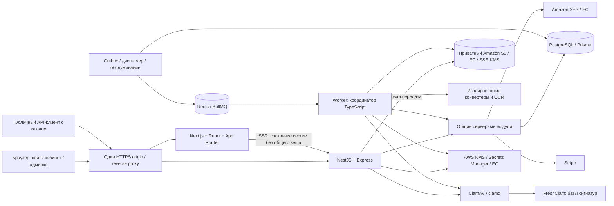

# Архитектура doc-converter

**Версия:** 2.1  
**Дата:** 28 октября 2026 г.  
**Основание:** ТЗ 1.36 и технологический стек 1.0 от 28 октября 2026 г.; прямое решение пользователя применять FSD во frontend от 28 октября 2026 г.  
**Статус:** проект архитектуры реализации на согласованном стеке. Разработка, развёртывание и приёмочные испытания этим документом не подтверждаются.

## 1. Источники, приоритеты и изменения редакции

Источники требований и выбранных технологий:

- [technical-specification-final.md](./technical-specification-final.md), **версия 1.36** — продуктовые правила, технические пределы и приёмка; далее **ТЗ**.
- [technology-stack.md](./technology-stack.md), **версия 1.0** — согласованные инструменты и границы их применения; далее **Стек**.

**Дополнение пользователя от 28 октября 2026 г.:** для фронтенда выбран **Feature-Sliced Design (FSD)**. Это решение закреплено в настоящей редакции architecture.md и применяется к сайту, кабинету и административной панели. Оно дополняет источники выше; синхронизированные ТЗ, Стек и другие Project-файлы этой правкой не изменяются.

Продуктовое поведение определяется ТЗ, технологии — Стеком. В ТЗ §§1 и 15.6 ещё упоминается прежний черновик Стек 0.2; это историческая ссылка: в этой архитектуре применяется фактически существующая версия 1.0, основанная на ТЗ 1.36. Исходные файлы не изменяются.

Обозначения документа:

- **Требование / выбранный стек** — уже закреплено в двух источниках.
- **Выбрано пользователем в чате** — дополнительное прямое решение; в этой редакции — FSD для frontend.
- **Архитектурное решение** — предложенная здесь организация реализации согласованного поведения: модули, таблицы, протоколы согласованности, каталоги.
- **Предложение** — явно не утверждённая источниками детализация, которую нельзя выдавать за выбор пользователя.

Главные изменения относительно architecture.md 1.0:

| Ранее предложено или оставлено открытым | Актуальная архитектура |
| --- | --- |
| HTTP backend в Next.js | Отдельное приложение **NestJS + Express**; Next.js обслуживает интерфейс |
| Очередь задач в PostgreSQL без Redis | **BullMQ + Redis**; PostgreSQL хранит предметные состояния и транзакционный outbox |
| Приватный локальный том для результатов | **Amazon S3 в ЕС, SSE-KMS**, AWS SDK v3; локальный зашифрованный диск — только временная работа |
| Не выбраны ORM, авторизация и интеграции | **Prisma, Better Auth, Stripe, SES, KMS и Secrets Manager** |
| Не выбраны движки и антивирус | **Sharp/libvips, pdf-lib, PDFium, LibreOffice, PaddleOCR/PP-StructureV3, ClamAV** |
| Админка не входила в согласованный объём | Закрытая административная панель входит в **этап 1**, с ролями и TOTP |
| Свободное разделение frontend по функциональным областям | **FSD**: слои, срезы, публичные интерфейсы и правила импортов; выбран пользователем |
| Реестр Q/D преимущественно открыт | Основной реестр **Q закрыт**, D1–D6 согласованы; дальнейшие технические работы не являются повторным согласованием продукта |
| Восстановление активной задачи могло предполагать повтор | Прерванная активная конвертация завершается ошибкой **без автоматического перезапуска** |
| Удаление аккаунта предполагало возврат остатка | Удаление останавливает задания и списания; **возврат остатка из-за удаления не создаётся** |

## 2. Тип архитектуры и состав системы

**Архитектурное решение:** monorepo, отдельный **Next.js frontend по FSD**, **модульный монолит NestJS** для backend и отдельные рабочие процессы. Модули backend разделены по ответственности, но не превращены в независимо развёртываемые микросервисы. HTTP-приложение и worker используют общую предметную логику.

Monorepo определяет организацию репозитория; модульный монолит — устройство backend; **выбранный пользователем FSD** — организацию frontend. FSD применяется внутри `apps/web`; серверные модули NestJS, очередь и worker сохраняют свои границы. Отсутствие FSD в тексте Стек 1.0 не делает его открытым вопросом: основание выбора — прямое решение пользователя, указанное в §1.



`Core` — общая библиотека, а не отдельный HTTP-сервис. На схеме показаны разрешённые прикладные связи; нативные конвертеры не получают доступ ко всем зависимостям своего координатора.

| Компонент | Ответственность и границы |
| --- | --- |
| Next.js | Публичные страницы, формы, кабинет, админка, локализация и SSR. Не хранит отдельную систему аккаунтов и не определяет права тарифа |
| NestJS + Express | Все серверные правила, Better Auth, публичный и веб-API, потоковые загрузки/ZIP, интеграции и административные проверки |
| PostgreSQL + Prisma | Источник истины: владельцы, права, квоты, задания, финансовые операции, служебные разрешения, удаления и отзывы |
| BullMQ + Redis | Транспорт и управление доставкой задач; не источник истины о тарифе, успехе, сессии или остатке квоты |
| Worker | Однократное начало обработки, запуск изолированного конвейера, контроль ресурсов, сохранение и финализация |
| Служебный процесс | Outbox, допуск к запуску, сверка очереди, очистка, платёжные/почтовые операции, проверка сроков |
| S3 + временные диски | Приватные результаты и исходники принятой очереди в S3; распаковка, нативная обработка и временный ZIP на зашифрованном диске |
| ClamAV | Проверка каждого неизменяемого входа до миниатюр, OCR и конвертации; при неполной проверке файл не допускается к обработке |
| AWS KMS / Secrets Manager | Ключи шифрования и секреты компонентов с минимальными полномочиями |
| SES / Stripe | Почта и платежи; содержимое документов им не передаётся |

Сайт и API используют один публичный HTTPS origin. Proxy направляет страницы в Next.js, серверные маршруты — в NestJS. Браузер работает с NestJS напрямую через этот origin: загрузка не проходит двойной цепочкой браузер → Next.js → NestJS. Для SSR Next.js обращается к внутреннему адресу NestJS и передаёт необходимый контекст сессии; персональные ответы и `Set-Cookie` не кешируются совместно между пользователями.

Обработка, PostgreSQL, Redis с предметными идентификаторами, S3, временные диски, журналы, секреты и резервные копии размещаются в **ЕС**. Рабочее имя `doc-converter` и зона `.ua` не определяют регион серверов. Стек выбирает AWS для перечисленных сервисов, но не утверждает страну/регион AWS, вычислительный хостинг или managed-размещение БД/Redis.

## 3. Структура monorepo и правила зависимостей

Дерево — проект будущего репозитория приложения, а не перечень уже созданных сервисов.

```text
doc-converter/
├── apps/
│   ├── web/                              # Next.js / React / App Router
│   │   ├── app/
│   │   │   └── [locale]/
│   │   │       ├── page.tsx               # Главная: один блок документов
│   │   │       ├── convert/               # Страницы направлений
│   │   │       ├── results/[jobId]/
│   │   │       ├── auth/
│   │   │       ├── account/
│   │   │       ├── pricing/
│   │   │       └── admin/                 # Закрытая панель этапа 1
│   │   ├── src/                          # FSD для сайта, кабинета и админки
│   │   │   ├── _app/                     # Провайдеры, стили, инициализация UI
│   │   │   │   └── i18n/                 # Серверная интеграция next-intl
│   │   │   ├── _pages/                   # UI страниц и их композиция
│   │   │   ├── features/                 # Выделяются по фактическому переиспользованию
│   │   │   ├── entities/                 # Повторно используемые модели UI
│   │   │   ├── shared/
│   │   │   │   ├── ui/                   # shadcn/ui + Tailwind
│   │   │   │   ├── api/                  # Клиент API NestJS
│   │   │   │   ├── i18n/                 # Локали, сообщения: uk / ru / en
│   │   │   │   └── lib/
│   │   ├── public/                       # Публичная статика, без документов
│   │   └── next.config.*
│   ├── api/                              # NestJS + Express
│   │   └── src/
│   │       ├── main.ts                   # HTTP, raw body Stripe, настройки потоков
│   │       ├── modules/
│   │       │   ├── auth/                 # Better Auth + прикладные ограничения
│   │       │   ├── accounts/
│   │       │   ├── conversions/
│   │       │   ├── files/
│   │       │   ├── billing/
│   │       │   ├── staff/                # Роли, TOTP, приглашения, согласия
│   │       │   └── operations/           # Состояние сервиса и готовность
│   │       └── common/                   # Guards, ошибки, фильтры, requestId
│   ├── worker/
│   │   └── src/
│   │       ├── main.ts
│   │       ├── processors/               # BullMQ, проверка состояния БД
│   │       └── runner/                   # Изоляция и жизненный цикл процессов
│   └── maintenance/
│       └── src/                          # Outbox, диспетчер, сверка, очистка
├── packages/
│   ├── core/
│   │   └── src/
│   │       ├── identity/                 # Аккаунт, коды, API-ключ, восстановление
│   │       ├── conversions/              # Допуск, task/input/result, публикация
│   │       ├── quotas/                   # Циклы, резервы, успехи, таймеры
│   │       ├── storage/                  # Объём, сроки, удаление, ZIP-группы
│   │       ├── billing/                  # Периоды, права, расчёты, обязательства
│   │       ├── staff/                    # Служебные полномочия и согласия
│   │       └── ports/                    # Storage, Queue, Crypto, Mail, Payment
│   ├── infrastructure/
│   │   └── src/
│   │       ├── database/                 # Prisma, транзакции и репозитории
│   │       ├── queue/                    # BullMQ / Redis
│   │       ├── storage/                  # S3 / SDK v3, encrypted temp
│   │       ├── auth/                     # Better Auth / Prisma adapter
│   │       ├── security/                 # KMS / Secrets Manager / ClamAV
│   │       ├── converters/               # Sharp, pdf-lib, PDFium, LibreOffice, OCR
│   │       ├── archive/                  # Archiver
│   │       ├── email/                    # SESv2
│   │       └── payments/                 # Stripe
│   ├── contracts/                        # DTO, коды ошибок, Zod-схемы контракта
│   └── config/                           # Проверка конфигурации при старте
├── workers/
│   └── ocr/                              # Локальный Python-адаптер при необходимости
├── prisma/
│   ├── schema.prisma
│   ├── migrations/
│   └── seed.*                            # Фиксированные тарифы, без тестовых секретов
├── deploy/
│   ├── docker/                           # Раздельные образы web/api/worker
│   ├── compose.yaml
│   ├── compose.production.yaml
│   ├── proxy/
│   └── .env.example                      # Только имена и безопасные примеры
├── docs/
│   ├── architecture.md
│   ├── api.md                            # Точный контракт до реализации API
│   └── operations.md                     # Выпуск, восстановление, служебный доступ
├── tests/
│   ├── integration/
│   ├── e2e/
│   └── fixtures/                         # Отдельно подготовленные контрольные файлы
├── package.json
└── <lockfile>                            # Один выбранный package manager
```

Выдаваемый документ остаётся `architecture.md` в корне текущего Project. `docs/architecture.md` — предлагаемое положение в будущем репозитории приложения. Package manager, CI-платформа и тестовый framework в источниках не выбраны; названия не подставляются как утверждённые. Дополнительный workspace-оркестратор не обязателен.

### 3.1. Направление зависимостей

1. `web` импортирует контракты и собственный UI, но не Prisma, серверные use cases, AWS/Stripe-секреты или конвертеры.
2. Контроллер NestJS получает проверенный контекст, вызывает прикладную операцию и отображает результат в HTTP. Правила квот не дублируются по маршрутам сайта/API.
3. `core` содержит предметные правила и операции, не зависит от Next.js, NestJS, Redis и конкретного движка. Внешние эффекты описаны портами.
4. `infrastructure` реализует порты. API, worker и maintenance связывают зависимости; операции одной транзакции получают один транзакционный контекст Prisma.
5. Worker не вызывает собственный публичный API и не использует пользовательский ключ для продолжения принятого задания. Он работает с доверенным служебным контекстом и состоянием владельца.
6. Платежный модуль меняет права через общую операцию смены тарифа и квот; модуль сотрудников использует явные разрешённые команды, а не прямое редактирование чужих таблиц.
7. Классификация, системные квоты и ошибки общие для всех каналов. Клиентские Zod-схемы помогают форме, но NestJS обязан повторно проверять вход и права.

### 3.2. Выбранная архитектура frontend: Feature-Sliced Design

**FSD выбран пользователем.** Next.js `apps/web/app/` остаётся точкой маршрутизации App Router: URL, layout, metadata и подключение страниц. Прикладной UI находится в `apps/web/src/`. `_app` и `_pages` обозначают слои FSD App и Pages без конфликта со специальными каталогами Next.js; подход описан в [официальной интеграции FSD с Next.js](https://feature-sliced.design/docs/guides/tech/with-nextjs). Псевдоним `@/` в web указывает на `apps/web/src/`.

| Слой | Ответственность в проекте | Примеры |
| --- | --- | --- |
| `_app` | Инициализация приложения, провайдеры, глобальные стили, подключение локализации | Провайдер next-intl, серверная конфигурация i18n |
| `_pages` | Композиция экранов и логика, относящаяся только к ним | Главная, конвертер, результаты, вход, кабинет, тарифы, административные экраны |
| `features` | Переиспользуемые пользовательские действия и их UI/состояние | Выбор страниц PDF, изменение порядка изображений, скачивание результата — при повторном использовании |
| `entities` | Переиспользуемые представления и модели предметных объектов frontend | Статус задания, сведения о сохранённом файле, безопасные данные сессии |
| `shared` | Общая инфраструктура и компоненты без продуктовых сценариев | shadcn/ui, HTTP-клиент NestJS, базовые утилиты, сообщения и настройки локалей |

Срезы группируются по предметному смыслу, а внутри делятся на сегменты по назначению. Пример среза, когда выбор страниц используется несколькими экранами:

```text
apps/web/src/features/select-pdf-pages/
├── ui/                  # Список миниатюр и элементы выбора
├── model/               # Локальное состояние и проверки выбора
├── api/                 # Запросы, принадлежащие этому действию, если нужны
└── index.ts             # Публичный интерфейс среза
```

Не каждый срез обязан иметь все сегменты. Компонент и его состояние сначала размещаются рядом с использующей их страницей; в feature/entity выносятся при наличии реальной общей ответственности и повторного использования. `shared` и `_app` организуются непосредственно по сегментам, без предметных срезов. Слои `features`/`entities` не создаются пустыми заранее; `widgets` не требуется для старта. При его обоснованном появлении положение в иерархии — между `_pages` и `features`.

**Правила импортов:**

1. Направление зависимостей: `_app → _pages → features → entities → shared`. Срез может импортировать любой строго нижележащий слой, пропуская промежуточные; вверх импортировать нельзя.
2. Срезы одного слоя не импортируют друг друга. Например, две features соединяются на уровне страницы, а не через взаимные зависимости. Внутри сегментов `_app` и `shared` действует их общая инфраструктурная ответственность.
3. Внешний потребитель импортирует срез через его публичный интерфейс `index.ts`, а не через путь к внутренним `ui/` или `model/`. Общие сегменты `shared` имеют собственные явные точки экспорта; общего barrel, экспортирующего весь проект, нет.
4. Если срез содержит server-only код, он раскрывается через отдельный `index.server.ts` и не переэкспортируется в клиентский `index.ts`. Браузер не импортирует SDK с секретами, Prisma или серверные модули monorepo.
5. Next.js `app/` связывает маршруты с `_pages` и инициализацией `_app`; форма конвертации и её прикладное состояние не дублируются в каждом `page.tsx`.
6. Общие DTO и схемы приходят из `packages/contracts`. UI-модель может добавлять состояние выбора/отображения, но не дублирует серверную авторизацию, денежные расчёты и квотные транзакции.

React Hook Form управляет состоянием форм; Zod и @hookform/resolvers — их проверками. shadcn/ui и Tailwind находятся в общей UI-основе. next-intl подключается через `_app/i18n`, а общие локали/сообщения доступны из `shared/i18n`. Новые библиотеки состояния и UI-kit выбором FSD не назначаются.

Клиентские обращения проходят через `shared/api` и NestJS одного origin. Для SSR выделяется server-only вариант клиента с явной передачей сессии запроса, без глобального хранения cookie пользователя. Его вызывают серверные страницы/компоненты через разрешённые интерфейсы. Только NestJS определяет действительные права пользователя и сотрудников; фронтенд показывает доступные действия по безопасному серверному ответу.

Проверка архитектуры frontend включает направления импортов, отсутствие связей соседних срезов и обхода публичных интерфейсов, а также отсутствие server-only зависимостей в клиентской сборке. Конкретное средство автоматизации этих проверок выбирается при настройке проекта; выбор FSD не означает уже установленный lint-плагин.

## 4. Модули backend и взаимодействие

| Модуль | Ответственность |
| --- | --- |
| Identity / Accounts | Регистрация, подтверждение, сессии, коды, смена email/пароля, резервные коды, гостевые контексты, API-ключ |
| Conversions | Приём, валидация, порядок входов, инспекция, задачи, результаты и пофайловые исходы |
| Quotas / Admission | Два независимых цикла, резервы, успешный расход, временные блокировки, текущие права и вместимость |
| Files / Storage | Приватные объекты S3, группы результатов, объём, срок выдачи, ZIP, логическое и физическое удаление |
| Billing | Каталог цен, календарные периоды, автопродление/grace, история денег, доплаты, возвраты и подтверждения Stripe |
| Staff | Поддержка/администратор, служебные сессии, TOTP, приглашения, согласия на конкретные файлы, аудит |
| Operations | Состояние сервиса и очередей, готовность компонентов, метрики без пользовательских документов |
| Maintenance | Публикация outbox, диспетчеризация, таймеры, очистка и сверка, доставка служебных операций |

Модули не требуют собственного сетевого сервиса или собственной БД. API и worker можно выпускать разными образами из одного commit, сохраняя совместимость общих контрактов и схемы. Нативные инструменты и Python OCR — отдельные исполнения внутри нашей инфраструктуры, а не публичные микросервисы.

## 5. Модель данных и транзакционные инварианты

Логическая модель ниже — архитектурное решение; окончательные поля, Prisma-схема и индексы разрабатываются при реализации. Не следует создавать вторую независимую таблицу сессий поверх Better Auth: прикладные поля расширяют или связывают её модель через выбранный Prisma-адаптер.

| Группа сущностей | Назначение |
| --- | --- |
| Аккаунт и модели Better Auth | Пользователь, подтверждение email, учётные данные и серверная сессия; границы обычной и служебной сессии |
| `guest_contexts`, `browser_access_contexts` | Серверные гостевые квоты и браузерный доступ к гостевым/неподтверждённым результатам |
| `verification_challenges`, `email_changes`, `recovery_requests` | Одноразовые коды, два этапа email, восстановление с новой почтой и общими дедлайнами |
| `recovery_code_sets`, `recovery_codes` | Раздельные пользовательские/служебные наборы; необратимые значения, однократное потребление и отзыв |
| `api_credentials` | Владелец, проверочное представление, зашифрованное полное значение для повторного показа, версия и отзыв |
| `entitlements`, `quota_cycles`, `quota_reservations`, `quota_successes` | Действующие права, два цикла категорий, резервы по входам и однократные успехи |
| `uploads`, `scan_results` | Непрозрачный S3 key, версия/контрольная сумма, размер, тип, результат полного антивируса |
| `jobs`, `job_inputs`, `processing_tasks`, `execution_records` | Операция/пакет, порядок и отказ каждого входа, единица исполнения, единственный запуск и fencing token |
| `admission_state`, `execution_slots` | Согласованный учёт индивидуальных/общих мест старта и ожидания |
| `outbox` | Надёжные намерения отправить задачу/выполнить внешний эффект; это не замена BullMQ как очереди |
| `result_groups`, `result_group_inputs`, `artifacts`, `storage_usage` | Результаты одного исходника либо объединённого PDF, их байты, готовность и срок |
| `subscriptions`, `paid_periods`, `subscription_operations` | Календарь, ожидающие переходы, актуальность операции, оплаченные права и grace |
| `payments`, `refunds`, `allocations`, `provider_events` | История фактических денег, резервы возврата/зачёта, события Stripe и защита от повторов |
| `financial_records`, `refund_contacts` | Отдельный минимальный финансовый реестр и ограниченный контакт существующего возврата после удаления |
| `staff_memberships`, `staff_invites`, `file_access_requests`, `file_access_grants` | Роли, активация/отзыв, конкретные разрешения на документы |
| `deletions`, `revocations`, `cleanup_operations` | Закрытие доступа, удаление объектов, запрет восстановления ранее отозванного состояния |

Не все перечисленные сущности обязательно требуют отдельной физической таблицы. Для Better Auth/Prisma необходимо проверить выбранную поддерживаемую версию и совместимость расширений до фиксации миграций.

Основные инварианты:

- Владелец задачи и результата — аккаунт либо гостевой контекст; API-ключ ссылается на аккаунт, а не владеет результатами. Неподтверждённый аккаунт имеет общие квоты на всех устройствах, но выдача его гостевых результатов остаётся привязанной к браузеру по ТЗ §10.1.
- Не более одного действующего API-ключа аккаунта; код/резервный код нельзя успешно потребить дважды при гонке.
- Один уникальный успех на `job_input_id`; один резерв связан с конкретным исходным циклом. Квота не выводится из длины Redis-очереди.
- Обычный вход создаёт одну processing task; объединённый PDF — одну task и несколько резервов входных изображений.
- Одна уникальная активная запись исполнения/разрешение старта на task. Повторная доставка сообщения не даёт права снова запустить нативный процесс.
- Публикация группы результата, учёт артефактов/байтов, успехов входов и освобождение резервов согласуются в одной транзакции.
- Удаление/истечение закрывает выдачу и снимает учитываемые байты сразу; физическое S3-удаление идемпотентно и может завершаться позже в пределах часа.
- Изменение тарифа, завершение входа, выпуск ключа и удаление аккаунта сериализуются по guard владельца. Глобальные/индивидуальные места берутся в едином порядке блокировок.
- Денежные операции одной подписки сериализованы; Stripe event ID и прикладные операции уникальны, зарезервированная под возврат стоимость не используется вторично.

**Данные:** размеры — целые байты, 1 МБ = 1 000 000 байт, 1 ГБ = 1 000 000 000 байт; границы включительны. Время — UTC, календарные месяцы не заменяются 30/180 днями. Деньги — точная десятичная или рациональная арифметика; целые евроценты на границе фактического списания/возврата. Только итог округляется по ТЗ §11.5; промежуточные денежные доли не округляются.

**БД:** короткие транзакции через единый контекст Prisma; ожидание Redis/S3/Stripe/конвертера вне блокировок. Для конкурентных переходов — явные условные записи и, где необходимо, параметризованные SQL-блокировки PostgreSQL в том же контексте. Порядок блокировок фиксируется и тестируется; повторы транзакционного конфликта не повторяют внешний эффект. Индексы — по владельцу/состоянию заданий, циклам, дедлайнам, outbox и внешним ID; связи и уникальность защищаются БД. Пул рассчитывается суммарно для API, worker, maintenance и миграций, без отдельного клиента на каждый запрос.

## 6. Единый допуск: права, квоты, вместимость и частота

Основание: ТЗ §§3–4, 8, 10.3, 12.8. Сайт, API, вкладки и устройства одного владельца обращаются к одной операции допуска.

### 6.1. Согласованные параметры

| Контекст | Документы / изображения до блока | Таймер категории | Файлов за операцию | PDF / DOCX / изображение | Хранилище | Активных задач + ожидающих |
| --- | --- | --- | --- | --- | --- | --- |
| Гость / неподтверждённый | 5 / 5 | 12 часов | 1 | 2 / 5 / 2 МБ | Кабинета нет; выдача 12 часов | 1 + 5 |
| Подтверждённый базовый | 5 / 5 | 5 часов | 1 | 2 / 5 / 2 МБ | 5 ГБ | 1 + 5 |
| Pro | 30 / 30 | 2 часа | До 5 | 30 / 30 / 25 МБ | 15 ГБ | 2 + 5 |
| Максимальный | 100 / 100 | 2 часа | До 5 | 100 / 100 / 50 МБ | 50 ГБ | 3 + 5 |

Сумма файлов: Pro — документы до 150 МБ, изображения до 125 МБ; максимальный — до 500/250 МБ. Для гостя/базового действует размер единственного входа. Каждый вход одновременно соответствует своему пределу. HTTP-накладные данные не уменьшают разрешённые байты файлов.

На весь сервис: до **5 активных конвертаций + 100 дополнительных ожидающих задач**. Локальная настройка concurrency каждого worker не заменяет этот общий предел. Enterprise в этапе 1 не активируется; договорные значения не назначаются.

### 6.2. Протокол допуска

1. Проверить сессию/гостевой cookie либо действующий публичный ключ; неподтверждённому аккаунту API не предоставляется. Применить индивидуальные и IP-пределы запросов.
2. Принять upload потоком в приватную временную область, проверить число/порядок, индивидуальные и суммарные байты. Запрос сверх пакетного числа отклонить, а не обрезать.
3. Каждый вход должен пройти антивирус до инспекции/рендера/OCR. Зафиксировать неизменяемый объект и связанный с ним результат сканирования; опасный/непроверенный вход получает отказ. Дорогая структурная проверка может завершиться пофайловой ошибкой в управляемом конвейере.
4. В короткой транзакции повторно проверить актуальные права владельца, отсутствие удаления/приостановки новых конвертаций, действительность текущего доступа, хранилище и блокировки. Они могли измениться за время передачи/сканирования.
5. Восстановить истёкший цикл соответствующей категории. Рассчитать остаток: порог минус успешные входы и действующие резервы **этого цикла**. Резерв не списывает попытку и не запускает блокировку.
6. Из допустимых файлов выбрать первые по порядку в пределах остатка. Записать отказы остальным. Например, остаток 2 из допустимых 5 даёт два принятых входа; поздняя ошибка одного не запускает третий.
7. Определить количество task: по одному на обычный вход либо одна на весь объединяемый набор. Проверить одновременно свободные места владельца и общую вместимость. Если все эти task не помещаются, **отклонить весь запрос по вместимости**, откатив резервы; частичного допуска только по очереди нет.
8. В той же транзакции занять места, сохранить job/input/task, ограничения и цикл каждого резерва, создать outbox. У источников принятых задач уже должны быть надёжно сохранённые байты S3. Если нет принятых входов, не создавать фиктивное успешное принятие.
9. После commit вернуть `202 Accepted`, `jobId`, принятые входы/отказы. Не ждать завершения конвертации. Диспетчер доставляет задачи в BullMQ; временная недоступность Redis не теряет уже подтверждённый допуск.

Допуск и диспетчеризация используют общий реестр мест в PostgreSQL. Свободное активное место может резервироваться под непосредственный запуск; оставшиеся task занимают места ожидания. Резерв старта считается занятым для последующих допусков и не позволяет сверх лимита принять «ещё одну очередь». Отдельно проверяются фактически выполняющиеся процессы: их не больше 5 на сервис и текущего индивидуального предела, кроме уже активных задач после понижения по ТЗ §4.3.

Граница `dispatch_pending/starting/active/waiting` — технический контракт реализации: она должна сохранять одновременно вместимость 5 + 100 и индивидуальную очередь +5, не терять принятые места при задержке Redis и не считать ожидание активными 10 минутами. Диспетчер не публикует бесконтрольное число runnable-сообщений и не запускает задачи владельца поверх его лимита. Проверяется и старт нового запроса, и запуск ранее ожидавшего.

Полное хранилище блокирует **новый** допуск. Ожидающие/активные ранее принятые задачи не проходят проверку размера и места заново по новому тарифу; весь принятый пакет сохраняется сверх квоты, если результат допустим по техническим пределам. При удалении аккаунта действует исключение §12 этого документа.

### 6.3. Циклы и смена тарифа

- При регистрации текущий гостевой расход и исходное окончание блока переходят в неподтверждённый аккаунт; далее квоты аккаунта общие во всех браузерах. Подтверждение email даёт полные 5/5 и снимает гостевые блокировки.
- Новый гостевой cookie после очистки/смены браузера даёт собственные 5/5. Старый серверный расход не сбрасывается, доступ к старым файлам без cookie не восстанавливается. Продуктовой квоты на IP нет; без необходимых cookie гостевая конвертация недоступна.
- При подтверждённом повышении уровня создаются новые полные циклы и снимаются обе блокировки.
- При понижении в каждый новый цикл переносится только уже успешный расход текущего цикла на момент перехода. При расходе не ниже нового порога стартует новый полный блок: Pro — 2 часа, базовый — 5 часов. Старый срок заменяется.
- Принятые задания сохраняют исходный цикл и ограничения: поздний успех списывается в нём и не уменьшает новую квоту, не запускает/не продлевает блок нового цикла.
- Продление, смена месяца/года без смены уровня и включение/выключение автопродления сами по себе не сбрасывают цикл, резервы и таймеры.
- Активные задачи после понижения завершаются; следующая из очереди стартует по текущей параллельности. При трёх активных и новом пределе один новых запусков нет, пока активных не станет меньше одного.
- Запоздавшее подтверждение своевременного действительного продления восстанавливает непрерывность прежних прав с учётом уникальных успехов; технический промежуточный downgrade не создаёт дополнительную полную квоту. Для этого сохраняются история прав/циклов и однократные события успеха.

Это закрытые требования ТЗ §§4.1, 4.3, а не прежний открытый Q16. Возвращать его статус «требует согласования» нельзя.

### 6.4. Rate limits и защита входа

| Область учёта | Предел |
| --- | --- |
| Создание заданий на владельца, сайт/API совместно | 10 запросов/мин |
| Состояние на владельца | 120/мин и не чаще одного раза в 5 секунд на задание |
| Скачивание на владельца | 10/мин; повтор ZIP тоже считается запросом |
| Динамические запросы на IP без статики | 3 000/мин |
| Создание на IP | 60/мин |
| Запросы писем с кодами/инструкциями на IP | 100/час |
| Неверный вход на IP | 60 за 15 минут; при превышении вход с IP приостановлен на 15 минут |
| Неверный пароль аккаунта | 5 за 15 минут → приостановка парольного входа на 15 минут |
| Письма с кодами/инструкциями на email | 5/час и 20/сутки, совместно между соответствующими операциями |
| Неверный пользовательский резервный код | 5 на аккаунт за 15 минут → только этот способ приостановлен на 15 минут |

Архитектурное решение: технические краткоживущие счётчики ведутся атомарно в Redis, а критичные для аккаунта блокировки/одноразовое потребление сохраняются в PostgreSQL и не исчезают от обычного перезапуска Redis. Конкретные окна и границы тестируются по ТЗ; Redis очереди не использует вытеснение ключей. Счётчики разных действий раздельны, ключ замены не меняет владельца. Доверие к `X-Forwarded-For` ограничено собственным proxy.

При превышении возвращать безопасную причину и время повтора. Действующие сессии и принятые задания не отменяются от блокировки парольного входа. Отказы внутри текущего парольного блока не продлевают срок. Платёжные письма не включаются автоматически в лимит писем с кодами. Обычный фоновый polling не чаще 5 секунд не повторяет загрузку/конвертацию.

## 7. Конвейеры конвертации и изоляция

### 7.1. Загрузка, антивирус и подготовка

NestJS принимает поток, ограничивая размер до записи лишнего объёма; пакет не собирается целиком в памяти. Содержимое проверяется независимо от имени/MIME клиента. Временный объект недоступен через публичные S3 URL. ClamAV/clamd проверяет каждый вход до миниатюр, PDFium, LibreOffice и OCR; FreshClam обновляет базы.

Хеш/неизменяемая версия исходника связывают результат сканирования с объектом, передаваемым обработчику. Проверка «чисто» не переносится на заменённые байты. Угроза, timeout, недоступный clamd/базы, превышение внутренних scan limits или неполная проверка дают пофайловый отказ без обхода и списания. Scan limits поддерживают разрешённые входы и DOCX; результат `scan skipped` не является успехом.

Для сайта PDF-инспекция после антивируса даёт число страниц и защищённые миниатюры: для одной страницы шаг выбора пропускается, для нескольких выбраны все. До запуска доступны удаление/замена входа и порядок изображений. Подготовка сама по себе не тратит попытки, но проходит ограничение запросов и управляемые ресурсы; нельзя создать неограниченный бесплатный render-конвейер рядом с основной очередью. Незапущенный upload и подготовка — временные данные, не файлы кабинета. Точный технический срок незапущенной подготовки сайта закрепляется в API-контракте; 30 минут черновика бота не объявляются автоматически новым правилом сайта.

Надёжное принятие означает исходник в S3 и запись допуска. При ошибке/прекращении загрузки выполняется очистка до 15 минут. Исходники принятой очереди не истекают просто по длительности ожидания.

### 7.2. Направления и выбранные движки

| Направление | Реализация и результат |
| --- | --- |
| JPG/JPEG, PNG, статический WEBP → PDF | Sharp/libvips готовит изображение, pdf-lib формирует PDF; отдельная группа на вход либо один общий PDF |
| PDF → JPG/WEBP | PDFium рендерит выбранные страницы, Sharp кодирует JPG/WEBP; группа с выходами выбранных страниц исходного PDF |
| Миниатюры PDF | PDFium + Sharp после полного антивируса; выдача только владельцу |
| DOCX → PDF | LibreOffice без интерфейса, отдельный профиль процесса и контролируемые шрифты; проверка итогового PDF |
| PDF → DOCX, включая сканы | PaddleOCR / PP-StructureV3 для макета/OCR и восстановления редактируемого документа; локальный Python-адаптер допускается |

Принимаются `.jpg` и `.jpeg` без учёта регистра; это один формат и одна категория квоты. Выход PDF → JPG имеет `.jpg`. PDF с паролем, анимированный WEBP, повреждения и подмена содержимого отклоняются. Другие направления не добавляются.

Для изображения → PDF: одна исправная картинка на одной странице A4, поля 10 мм, центрирование, пропорциональное вписывание с увеличением/уменьшением без обрезки. Горизонтальная — альбомная, вертикальная/квадратная — книжная ориентация, отдельно для каждой страницы. PNG/WEBP-прозрачность заменяется белым; пользовательского переключателя нет.

Для PDF → JPG/WEBP: 72/150/300 DPI, по умолчанию 150; качество 1–100, по умолчанию 85. Одна пара параметров на всю операцию; отсутствие поля даёт default, недопустимое значение отклоняется. Белый фон не меняет исходный размер/ориентацию PDF на A4. Значения не понижаются автоматически ради прохождения лимита.

### 7.3. Ресурсы и единица исполнения

| Ограничение | Граница |
| --- | --- |
| Входное/выходное изображение | Одновременно ≤ 40 000 000 пикселей и ≤ 12 000 по каждой стороне |
| DOCX после распаковки | ≤ 500 МБ фактического содержимого и ≤ 10 000 внутренних файлов |
| Выходы одного исходника | Суммарно ≤ 500 МБ; для PDF → изображения — сумма всех выбранных страниц |
| Объединённый PDF | ≤ 500 МБ на итоговый файл |
| Активная обработка task | ≤ 10 минут, включая OCR/вспомогательные процессы; upload, очередь и download исключены |
| Память task | ≤ 2 ГБ совместно с OCR и всеми вспомогательными процессами |

Объединение — одна task с общими 10 минутами/2 ГБ, а не по лимиту на каждое изображение. ZIP не входит в 500 МБ результата и не учитывается повторно в хранилище. Отдельного продуктового/тарифного ограничения числа страниц PDF нет. Проверка выбранного DPI учитывает пиксели до дорогого рендера, где это возможно; при превышении предлагает выбрать меньшее DPI, не меняя его сама.

Координатор не выполняет тяжёлый нативный код в event loop BullMQ. Runner запускает отдельную ограниченную среду на task: отдельные рабочие файлы, непривилегированный пользователь, ограниченный mount, запрет исходящей сети и исполнения активного содержимого, лимиты ресурсов на всё дерево процессов. По deadline, превышению памяти и удалению аккаунта реально останавливаются все дочерние процессы; одного Promise timeout недостаточно.

Worker с доступом к Prisma/S3 не является достаточной песочницей для конвертера. Runner получает только файлы своей task и безопасные параметры; ему не передаются секреты БД, Stripe, SES, пользовательские ключи или Docker socket. Конкретный механизм Linux-изоляции и его профиль проверяются на выбранном хостинге до production. Системные библиотеки, шрифты и OCR-модели входят в воспроизводимый worker-образ и не скачиваются по запросу пользователя.

### 7.4. Частичный успех и публикация

Обычные допущенные входы независимы. В объединении сначала проверяются/готовятся изображения; ошибочные исключаются, исправные сохраняют относительный порядок. Если исправных нет, пустой PDF не создаётся. Успех объединения публикуется после готовности общего PDF: списание по каждому участвовавшему исправному изображению, байты одного PDF — один раз. Ошибка создания общего PDF не списывает попытки входных изображений.

ТЗ не задаёт самостоятельную тарификацию частично готовых страниц одного PDF. Архитектурное решение — публиковать успех входного PDF после готовности всех выбранных выходов; при неуспешной обработке входа его неполный набор не выдаётся за готовый полный результат. Ошибки отдельных входов не подменяют ранее отказанные входы автоматически.

Перед публикацией проверить формат, размер/manifest и надёжное сохранение в S3. Успех конвертера без сохранённого результата не показывается как успех сервиса. Затем одной транзакцией зафиксировать группу, артефакты, байты, уникальные успехи и освобождение резервов; проверка актуальности владельца и execution token обязательна.

OCR этапа 1: печатный текст на русском, украинском, английском, французском, немецком и польском, автоопределение и смешанные документы. Приоритеты Стек §5 — точность цифр и таблиц. На каждом утверждённом чётком контрольном скане CER ≤ 2% без пробелов/переносов, без усреднения между документами. Редактируемость, порядок текста, абзацы, заголовки, списки, изображения и простые таблицы проверяются на полном пути до DOCX. Выбор PP-StructureV3 не подтверждает качество; сложные макеты/таблицы/формулы проверяются отдельно. Пользовательские рабочие документы не используются для тестов или обучения.

## 8. PostgreSQL, outbox и BullMQ без повторной конвертации

### 8.1. Разделение источников истины

PostgreSQL хранит принятый job/task, владельца, места, цикл, состояние выполнения и публикации. Redis/BullMQ хранит сообщения для запуска и их транспортные состояния. В Redis не передаются документы, исходные имена, API-ключи и секреты; сообщение содержит непрозрачный task ID и версию контракта.

**Архитектурное решение:** транзакционный outbox связывает запись допуска и доставку BullMQ. В транзакции создаются task и событие; maintenance публикует его с детерминированным `jobId`, затем фиксирует доставку. Падение между отправкой Redis и отметкой БД даёт повтор доставки сообщения, который не означает повтор запуска конвертера. Для конкурентного чтения outbox допустим короткий захват строк PostgreSQL с `SKIP LOCKED`; это не PostgreSQL-очередь обработки документов прежней редакции.

Redis хранит очередь на постоянном защищённом носителе, с persistence и `maxmemory-policy=noeviction`. Обязательны ограничение сети/доступа, контроль памяти и ошибок. Эти требования соответствуют [рекомендациям BullMQ для production](https://docs.bullmq.io/guide/going-to-production). Потеря Redis не уничтожает предметное состояние: outbox/сверка восстанавливают только ещё не начатые допустимые task с сохранёнными исходниками.

### 8.2. Однократное начало и финализация

1. Диспетчер выдаёт task согласованный активный слот; сообщения ожидающих task не получают права стартовать поверх текущей параллельности.
2. При доставке worker сверяет БД: владелец не удалён, task не терминальная, запуск ещё не начат, слот действителен. Атомарно создаёт единственную запись исполнения и fencing token, после чего запускает конвертер.
3. Повторная доставка для уже начатой/терминальной task **не запускает процесс**. Живая исходная обработка может продолжаться; потерянная приводится к ошибке процедурой восстановления.
4. Исполнение поддерживает heartbeat. При потере права исполнения supervisor останавливает runner; старый token не даёт опубликовать результат. Слот не считается свободным до остановки прежнего дерева процессов либо подтверждённой гибели узла.
5. Готовые объекты записываются под уникальными ключами исполнения и до commit не выдаются пользователю. Публикация БД выполняется ровно один раз по ограничениям уникальности и условным переходам.
6. Если commit успеха произошёл, но подтверждение BullMQ потеряно, БД уже содержит терминальный успех: повтор сообщения только завершает транспортное согласование, без нового списания/конвертации.

### 8.3. Ошибки, stalled и восстановление

**Требование:** автоматического повторного запуска неуспешной или прерванной активной конвертации нет. Для conversion task предлагается `attempts: 1`; отдельно исключается повтор после потери lock. Одной настройки attempts недостаточно: BullMQ способен возвращать stalled task в ожидание, что описано в [документации BullMQ](https://docs.bullmq.io/guide/jobs/stalled).

Поэтому поведение stalled настраивается и проверяется для закреплённой версии библиотеки, а БД-guard однократного начала защищает независимо от механизма повторной доставки. Нельзя добавлять `job.retry()` для конвертаций через админку. Транспортные повторы доставки, повтор безопасной очистки и согласованные платежные повторы — отдельные операции, не повтор конвертера.

| Состояние на момент сбоя | Обязательное поведение |
| --- | --- |
| Ожидало, исходник S3 сохранён | Восстановить доставку/очередь и выполнить первый запуск в согласованных местах |
| Активная конвертация прервана | Ошибка без списания, освобождение резервов и мест после остановки; новый запрос только вручную |
| Ожидало, исходник утрачен | Ошибка без списания и автоматической повторной загрузки |
| Успех зафиксирован, файлы сохранены | Сохранить успех, исходные сроки и однократный учёт |
| Объекты записаны, публикация не завершена и исполнение прервано | Не объявлять новый успех задним числом; закрыть задачу ошибкой без списания и очистить неподтверждённые объекты |
| Аккаунт удалён | Не восстанавливать очередь/исполнение/публикацию, применить удаления и отзывы |

Нет общей атомарной транзакции PostgreSQL + Redis + S3. Корректность обеспечивают outbox, неизменяемые исходники, conditional state transitions, уникальность, fencing и регулярная сверка. Ошибки/незавершённые cleanup-команды не должны оставлять вечные резервы или публично доступные сироты.

## 9. API и обмен с frontend

Пути, имена полей и заголовок ниже — **предложение технического контракта**. ТЗ §9.4 требует закрепить точную спецификацию до реализации; согласованное поведение Q11 не открывается заново.

| Маршруты | Контекст |
| --- | --- |
| `/api/v1/*` | Публичный API, действующий ключ подтверждённого аккаунта; предлагается `Authorization: Bearer <key>` |
| `/api/web/*` | Собственный сайт: Better Auth session или гостевой cookie с правами конкретной операции |
| `/api/auth/*` | Better Auth и прикладные сценарии подтверждения/восстановления; все в NestJS |
| `/api/admin/*` | Служебная сессия, TOTP, актуальная роль и разрешение конкретного действия |
| `/api/payments/stripe/webhook` | Проверка подписи Stripe по raw body; не пользовательская сессия |

Все перечисленные серверные пути proxy направляет в NestJS. Имя `/web` или скрытая страница `/admin` сами по себе не защищают запрос. Cookie сайта не заменяет обязательный ключ публичного API. CORS не открывается произвольным сторонним сайтам.

| Метод и предлагаемый путь | Назначение |
| --- | --- |
| `POST /api/v1/jobs` | Multipart с файлами в явном порядке, одним направлением и общими настройками; `202`, `jobId`, пофайловый допуск/отказы |
| `GET /api/v1/jobs/{jobId}` | Агрегированное состояние, состояния входов, причины ошибок, группы результатов и сроки |
| `GET /api/v1/results/{groupId}/zip` | Новый временный ZIP группы, доступ только действующему ключу владельца |
| `POST /api/web/uploads` | Временная загрузка и управляемая подготовка формы; не успешная конвертация |
| `GET /api/web/uploads/{id}` и `/thumbnails/{page}` | Состояние подготовки/число страниц и защищённые миниатюры после антивируса |
| `POST /api/web/jobs` | Допуск подготовленных файлов с неизменяемыми параметрами |
| `GET /api/web/jobs/{id}` и `/api/web/results/{groupId}/zip` | Состояние и ZIP по веб-контексту владельца |
| `/api/web/account/*` | Профиль, коды, email/пароль, резервные коды, API-ключ и удаление |
| `/api/web/files/*` | Список сохранённых результатов, объём, удаление группы и подтверждённая полная очистка |
| `/api/web/billing/*` | Оплата, автопродление, смена/отмена, состояния денежных операций |
| `/api/admin/*` | Только согласованные ТЗ просмотры и команды из §13 этого документа |

Предлагаемые состояния: `queued → validating → converting → persisting → succeeded/failed` на уровне задачи/входа; операция агрегирует `completed/partially_succeeded/failed`. Отказ при допуске отличается от ошибки исполнения. Инспекция, upload и ZIP имеют собственные состояния и не притворяются конвертацией. Точный процент не показывается без достоверного измерения.

```json
{
  "jobId": "opaque-job-id",
  "status": "queued",
  "inputs": [
    { "index": 0, "status": "accepted" },
    { "index": 1, "status": "rejected", "error": { "code": "QUOTA_REMAINDER" } }
  ]
}
```

Пример показывает формат частичного допуска, не новый тариф. Ошибки имеют машинный `code`, понятное безопасное сообщение, `requestId` и при необходимости лимит/время повтора. UI переводит стабильные коды через next-intl. Категории HTTP — ТЗ §9.4: `2xx`, `400`, `401`, `403/404`, `413`, `415`, `422`, `429`, `5xx`; окончательное соответствие закрепляется контрактом. Статусы отдельных файлов принятого задания возвращаются внутри состояния.

Каждый публичный GET состояния/ZIP заново проверяет действительность ключа и аккаунт владельца. Новый ключ того же аккаунта открывает его старые доступные результаты; чужой, отключённый или старый — нет. Одного непрозрачного ID недостаточно. При отсутствии нового ключа после отзыва API недоступен, кабинет работает по сессии.

Закрытие вкладки, сеть, смена пароля, окончание сессии или отзыв API-ключа не отменяют принятое задание. Сайт показывает browser-supported предупреждение выхода, но сервер от него не зависит. Пользовательского endpoint отмены и webhook о готовности конвертации нет. Новая ручная отправка — новая обработка; автоматической пересылки входов нет. Защита от повторной финализации не является обещанием дедупликации произвольных новых запросов этапа 1. Специальные operation ID бота относятся к этапу 2.

## 10. Хранилище S3, объём, сроки и ZIP

### 10.1. Логические области

```text
S3, ЕС, приватные объекты / SSE-KMS:
  temporary/<opaque-upload-id>/       # Недоверенный вход / подготовка / принятая очередь
  results/<opaque-artifact-id>/       # Готовые результаты с метаданными в PostgreSQL

Зашифрованный временный диск исполнения:
  work/<execution-id>/               # Файлы только одной task, профили LibreOffice
  downloads/<download-id>.zip         # Временный архив Archiver

Отдельное зашифрованное хранилище копий, ЕС:
  recovery-points/<id>/               # Манифест и разрешённый состав копии
  restore-guards/                    # Независимые от отката сведения удалений/отзывов
```

Ключи S3 не строятся из пользовательского имени. Реальные bucket/prefix/регион и IAM-политики фиксируются в deployment-конфигурации; схема выше — логическая. KMS-ключ S3 находится в том же регионе, что bucket. SSE-KMS не заменяет шифрование PostgreSQL, Redis, временных дисков и копий.

Чтение/запись выполняют авторизованные служебные компоненты через AWS SDK for JavaScript v3. Конвертеру не выдаются широкие credentials S3/KMS. Публичные объекты и выдача пользователю долговечных прямых S3-ссылок не используются: загрузка/скачивание идут через NestJS с текущей проверкой доступа. Документы не размещаются в Next.js `public/` и не передаются стороннему image-optimizer.

### 10.2. Группы результатов и объём

- Обычный исходник имеет свою группу. PDF → изображения содержит только выбранные страницы этого PDF.
- Без объединения каждое изображение имеет группу с отдельным PDF; с объединением — общая группа с одним PDF и связями с участвовавшими входами.
- Объём аккаунта — готовые доступные артефакты, каждый уникальный файл один раз. Исходники, подготовительные миниатюры, work и ZIP в квоту не входят.
- Все успешные результаты подтверждённого аккаунта, включая базовый и API, сохраняются автоматически. Отключения сохранения нет.
- Предупреждение при 75%: 3,75/11,25/37,5 ГБ. С 100% новые конвертации блокируются; старые файлы ради новых не удаляются.
- Если место было при допуске, принятый результат и весь принятый пакет сохраняются сверх 5/15/50 ГБ, в том числе после понижения тарифа. Технический предел результата 500 МБ сохраняется.

Готовность группы фиксирует `ready_at` и неизменяемый `expires_at`: подтверждённому аккаунту — **6 календарных месяцев**, гостю/неподтверждённому — **12 часов**. Скачивание/переоткрытие не продлевает срок. При календарном прибавлении не используется 180 дней; правило даты конца месяца фиксируется в общей календарной реализации и проверяется тестом. Неподтверждённый аккаунт не получает кабинет/межустройственное восстановление гостевых результатов только из-за общего серверного расхода квот.

### 10.3. Временный ZIP Archiver

1. NestJS проверяет действующего владельца, группу, срок, отсутствие удаления и перечень артефактов.
2. Archiver собирает **отдельный временный файл** на зашифрованном диске. Потоки S3 → архив не требуют удержания всего архива в памяти.
3. Перед выдачей повторно проверяются права и доступность; затем NestJS передаёт файл потоком через proxy.
4. При успехе, ошибке и обрыве временный ZIP удаляется. Осиротевшие после аварии файлы очищаются в течение часа после восстановления.

ZIP нужен даже для одного выхода; одна кнопка на исходник либо одна на объединённый PDF. Общего ZIP всего пакета нет. Повторное ручное скачивание создаёт новый ZIP из готовых артефактов, с начала и без HTTP Range; конвертер, попытки и срок не меняются. Архив не кешируется публично и не учитывается в квоте повторно.

При удалении/истечении выдача прекращается сразу. Активные серверные download-потоки отслеживаются, прекращаются при запрете доступа; уже полученные клиентом байты технически не отзываются. Проверка прав/состояния непосредственно перед сборкой и выдачей закрывает гонку между ожиданием ZIP и удалением результата. Для подтверждения скачивания учитывается серверное завершение потока, а не обещание записи файла устройством пользователя.

### 10.4. Очистка и исключение утечек

| Событие | Срок и действие |
| --- | --- |
| Успех, ошибка или прекращение загрузки | Исходники/work удаляются сразу, максимум через 15 минут от события |
| Принятая ожидающая task | Исходник сохраняется до исполнения; очередь сама по себе не запускает TTL удаления |
| Удаление результата/аккаунта, полная очистка, истечение срока | Доступ и учёт байтов прекращаются сразу; физическое основное хранилище очищается в течение часа |
| Авария | Остаточные временные данные очищаются в течение часа после восстановления, с сохранением исходников продолжающейся очереди |
| Временный ZIP | Удаление после выдачи, ошибки/обрыва; постоянного хранения нет |

Удаление реализовано устойчивой командой: транзакция закрывает доступ, снимает байты один раз и записывает cleanup; worker/maintenance удаляет S3-объекты и временные файлы с проверяемым результатом. При версионировании удаляются все подлежащие очистке версии, а не только ставится delete marker; незавершённые multipart-upload также очищаются. S3 Lifecycle — страховка, а не основной механизм часового срока.

Логическое освобождение пользовательских байтов и фактический объём занятого носителя контролируются раздельно. Повтор cleanup не уменьшает usage дважды. Полная очистка хранилища требует подтверждения и не отменяет принятые конвертации; удаление аккаунта останавливает их специально.

## 11. Better Auth, пользовательский доступ и восстановление

### 11.1. Серверные сессии

Better Auth работает только в NestJS с Prisma/PostgreSQL. Cookie содержит непрозрачный идентификатор; `session.cookieCache` отключён, Redis не используется вторым хранилищем сессий. NestJS при каждом защищённом запросе проверяет актуальную сессию, статус аккаунта, email, роль и права действия. Возможности cookie cache и secondary storage описаны в [Better Auth](https://better-auth.com/docs/concepts/session-management); в проекте они не должны сохранять доступ после отзыва.

| Сессия | Бездействие | Абсолютный предел от входа |
| --- | --- | --- |
| Пользовательская | 7 суток | 30 суток |
| Служебная | 15 минут | 8 часов |

Действует более ранний срок. Нужны отдельные `authenticated_at` и время значимой активности: обычный sliding TTL библиотеки не заменяет абсолютную границу. Фоновый polling не обновляет активность; смена session ID не начинает срок заново; активность другого устройства/обычного кабинета не продлевает служебную сессию. Истечение сессии не отменяет task и не отзывает отдельный API-ключ.

Cookie защищены `Secure`, `HttpOnly` и подходящим `SameSite`; изменяющие запросы защищены от CSRF и подделки origin. Нет общего кеша персональных ответов. Автоматические lifecycle hooks Better Auth не должны обходить прикладные транзакции отзыва, квот и восстановления.

### 11.2. Пароли и почтовые операции

Пароль — 8–128 символов, с пробелами, Unicode и вставкой; обязательных классов символов нет. Известные скомпрометированные/распространённые пароли отклоняются. Пароль не обрезается и хранится необратимо; алгоритм и параметры согласуются с закреплённой версией Better Auth и проверяются до реализации. Нельзя превращать пароль в обратимо шифруемое значение ради KMS.

Регистрация занятого email возвращает то же внешнее сообщение, не создаёт дубль и не меняет пароль; существующему адресу отправляются инструкции вместо подтверждения чужого доступа. Все маршруты регистрации/смены/восстановления используют одинаковую парольную политику и лимиты.

Код: 6 цифр, 10 минут, максимум 5 попыток, переотправка не чаще минуты; одноразовое потребление и счётчик атомарны. Код связан с адресом, аккаунтом и конкретной операцией; защищённое представление не должно позволять автономно перебрать всего миллион вариантов при утечке БД. Значения кодов не журналируются.

Смена email: сначала код старого адреса, затем нового; общая операция 20 минут от первого письма без продления, каждый код имеет собственные 10 минут. Доступность нового адреса проверяется до отправки и при commit; аккаунты не объединяются. Отзыв всех сессий/ключа после успеха включён по умолчанию, пользователь может выключить его. Пока операция не завершена, адрес и доступ не меняются.

Смена/сброс пароля всегда отзывает все сессии, включая текущую, и API-ключ в согласованной операции. Уже принятые конвертации продолжаются. Вход затем с новым паролем; новый ключ выпускается вручную после окончания текущих конвертаций.

### 11.3. API-ключ и криптографические границы

Один ключ выпускается вручную; замена после почтового кода сразу отзывает старый. Выпуск/замена запрещены при текущих конвертациях, включая принятые ожидающие: проверка и допуск новой task используют одну блокировку владельца. Worker не зависит от действительности этого ключа после принятия.

Для повторного раскрытия владельцу сохраняются отдельно проверочное представление и обратимо зашифрованное полное значение. Архитектурное решение — envelope encryption с AWS KMS и аутентифицированным шифрованием данных; выбор формата, key ID и ротация описываются реализацией безопасности. Ключи KMS не находятся рядом с данными, доступ расшифровки ограничен собственным просмотром владельца/разрешённым компонентом. Сотрудникам значение не раскрывается. Ключ не появляется в URL, логах и сообщениях ошибок.

Secrets Manager хранит конфигурационные секреты Better Auth, Stripe и соединений; KMS используется для ключевого материала и шифрования. Шифрование S3 и обратимое хранение API-ключа не подменяют необратимое хранение пароля/резервного кода. Ротация сохраняет возможность расшифровки допустимых копий в пределах их срока.

### 11.4. Потеря почты и резервные коды пользователя

После подтверждения email предлагается набор из **10 одноразовых пользовательских кодов**; выпуск/замена в кабинете подтверждается почтовым кодом. Показ однократный, хранение необратимое; замена отзывает весь прежний набор. Это не шестизначные почтовые коды и не служебные TOTP-коды.

Восстановление: прежний email + действующий резервный код → подтверждение нового свободного email → новый пароль. Операция ограничена 20 минутами от проверки резервного кода. Только успешное общее завершение применяет email/пароль и однократно потребляет код; конкурентные операции не завершаются одним кодом. Незавершённая попытка не меняет доступ.

При успехе отключаются весь старый набор, сессии, API-ключ, незавершённые запросы учётных данных и прежняя привязка бота; уведомления без секретов — на старый/новый адрес. Автовхода и новой квоты нет. Файлы, подписка, деньги и исходные сроки сохраняются; принятые конвертации продолжаются. Отзывы/использование кодов должны переживать восстановление старой БД.

Без кода предусмотрено обращение в поддержку без гарантированного восстановления; один чек недостаточен, файлы/секреты не передаются сотруднику как способ доказательства. Ручная процедура исключена пользователем из текущей проработки; архитектура не добавляет обход по одному email или произвольную смену владельца через админку.

## 12. Удаление аккаунта и необратимое прекращение доступа

Основание: ТЗ §§6.4, 10.4–10.5, 11.13. Это системная остановка, не пользовательская функция отмены отдельной конвертации.

1. Проверить почтовый код и предупреждение: удалятся аккаунт/файлы, платный доступ прекратится, возврат остатка именно из-за удаления не создаётся.
2. Под guard владельца закрыть доступ, отозвать сессии/ключ/разрешения, пометить lifecycle generation как недействительную для worker. Сохранить устойчивые намерения удаления и остановки; дальнейший допуск/публикация запрещены.
3. Снять ожидающие task из runnable-очереди и аннулировать их транспортные сообщения. Доставленный поздно outbox/job проверяет tombstone и не запускается. Активные runner системно остановить со всем деревом процессов; неподтверждённые результаты удалить.
4. Согласованно завершить резервы/места и удалить профиль/сохранённые объекты; доступ закрыт сразу, временные файлы — до 15 минут от остановки, основные результаты — до часа. Идемпотентная повторная команда не возвращает данные и не уменьшает счётчики повторно.
5. Прекратить подписку, автопродление и будущие списания через устойчивую команду Stripe. Пока подтверждение внешней отмены задерживается, локальные права уже закрыты; позднее устаревшее списание обрабатывается возвратом по ТЗ §11.11.
6. **Не создавать возврат за оставшийся оплаченный период.** Ранее возникшие обязательства возврата и возврат ошибочного/устаревшего списания сохраняются и не дублируются.
7. Минимальный финансовый реестр остаётся отдельно по применимой обязательной политике; профиль/документы не сохраняются под этим предлогом. Контакт возврата создаётся только при существующей соответствующей операции: последний подтверждённый email до успеха и удаление в течение 30 дней после успеха.

Публикация результата и удаление конкурируют через одну проверку владельца/token в транзакции. Если успех был зафиксирован раньше, удаление закрывает и его результат; если удаление раньше — публикация запрещена. Поздний worker не создаёт аккаунт повторно. Независимый журнал удалений/отзывов блокирует воскресший доступ при восстановлении копии, включая сессии, ключи, резервные коды и будущую привязку бота.

## 13. Административная панель и доступ сотрудников

Панель этапа 1 находится в Next.js, а все полномочия проверяет NestJS. Служебная роль не выдаётся публичной регистрацией. Сотрудник входит по email/паролю и TOTP; до завершения второго фактора нет обычного служебного доступа.

| Роль | Разрешённые действия |
| --- | --- |
| Поддержка | Необходимые данные пользователей, лимитов, заданий и оплат для обращений; запрос согласия на конкретные файлы |
| Администратор | То же; журналы/состояние системы, служебные аккаунты, приостановка/возобновление новых конвертаций с причиной, отдельный отзыв API-ключа без раскрытия значения; повтор той же неуспешной операции возврата без изменения суммы |

Приостановка новых конвертаций не отменяет принятые задачи, не блокирует кабинет, скачивание и подписку. Отзыв API-ключа не отменяет принятые задачи; возобновление конвертаций ключ автоматически не включает. Поддержка не получает эти изменяющие права. Нет ручного редактирования тарифов, цен, квот, сумм возвратов или активации Enterprise. Администратор не получает кнопку повторного запуска упавшей конвертации.

Обычный просмотр панели не раскрывает документы, пароли, почтовые/резервные коды и пользовательские API-ключи. Для содержимого нужен запрос конкретного сотрудника с причиной/обращением и перечнем файлов. Пользователь видит запрос и подтверждает почтовым кодом. Grant связан с сотрудником и точными файлами, действует до 24 часов от подтверждения либо до закрытия обращения, отзыва или срока файла — что раньше. Проверка выполняется на каждом обращении; отключённый сотрудник не сохраняет доступ через старый grant. Все этапы и обращения журналируются без содержимого и имён.

Приглашение сотрудника на email с ролью одноразовое, 24 часа. Активация требует собственного пароля, настройки TOTP и полноценного входа. Отключение/смена роли применяются сразу, служебные сессии отзываются; последнего фактически действующего администратора нельзя отключить/понизить через панель. Проверка последнего администратора транзакционная, учитывает гонки и не считает неактивированные приглашения.

Служебные резервные коды — отдельные 10 одноразовых кодов с однократным показом. Пароль + резервный код открывают только ограниченную настройку нового TOTP, без полного доступа. После завершения старый фактор/коды/сессии отзываются и выдаётся новый набор. Полная утрата факторов восстанавливается владельцем проекта через инфраструктурную процедуру, без email-only обхода. TOTP-секрет защищается механизмом Better Auth и отдельным серверным секретом; хранение/проверка служебных кодов сохраняет одноразовость при гонках и restore.

Первый администратор создаётся отдельной закрытой deployment-командой с последующей настройкой TOTP, не публичным HTTP endpoint и не стандартным паролем в seed. Детали безопасного bootstrap и инфраструктурного восстановления фиксируются в operations runbook до запуска; процедура не предоставляет сотрудникам произвольный доступ к пользователям.

## 14. Платежи Stripe, периоды и финансовая история

### 14.1. Граница интеграции

**Выбран Stripe.** Продуктовые суммы/даты/права определяет сервер по ТЗ, а не defaults Stripe. Покупка только подтверждённому аккаунту. EUR: Pro €5/месяц или €51/год; максимальный €10/месяц или €102/год. Это конечные цены с применимыми налогами, без обязательных сборов сервиса сверх прайса; платного trial нет. Продавец — ФОП в Украине; это статус из ТЗ, не подтверждение выполненного подключения Stripe.

Архитектурное предложение для платёжного UI — Stripe Checkout с Billing API. Точная конфигурация Checkout, периодов, будущих списаний, retries и перерасчётов проверяется на выбранной поддерживаемой версии SDK/API и в тестовом окружении. Нельзя подключить default Customer Portal так, чтобы он давал несогласованные переходы, кредит на внутренний баланс или иной возврат. Поддерживаемые пути изменения подписки контролируются прикладным billing-модулем.

Webhook NestJS получает неизменённый raw body и проверяет `Stripe-Signature` официальным SDK до доверия событию; это требование [Stripe webhooks](https://docs.stripe.com/webhooks). После надёжной фиксации проверенного события обработка может идти асинхронно; `2xx` не возвращается до сохранения события. Уникальный event ID дополняется уникальностью прикладной операции: разные события одной оплаты тоже не должны активировать её дважды. Raw payload и карточные реквизиты не попадают в журналы.

### 14.2. Права и денежные переходы

| Событие | Поведение |
| --- | --- |
| Первая оплата | Права после серверного подтверждения суммы/EUR/тарифа/аккаунта, период от активации |
| Выключить автопродление заранее | Оплаченный доступ до конца; затем базовый без grace, будущих списаний нет |
| Немедленно отменить | Базовый сразу, прекратить будущие списания, вернуть неиспользованный оплаченный остаток на карту |
| Повысить с доплатой | До подтверждения прежние права/даты; после успеха новый уровень и квоты по правилам перехода |
| Понизить | Права меняются сразу; разница остатка возвращается на карту; ошибка возврата не откатывает downgrade |
| Pro ↔ максимальный при том же типе периода | Конец оплаченного периода сохраняется, перерасчёт относится к остатку |
| Месяц ↔ год | Новый полный календарный период от успешного перехода, однократный зачёт старого остатка; доплата/возврат разницы, без пользовательского баланса |
| Удаление аккаунта | Права/подписка/будущие списания прекращаются; возврат остатка из-за удаления не создаётся |

Календарь UTC: месяц/год от исходной календарной опоры и времени, с переносом на последний день при отсутствии числа и восстановлением исходного числа в следующем периоде: 31 января → конец февраля → 31 марта. Хранится исходная опора, а не только результат прибавления к предыдущему короткому месяцу. Секунды и реальная длительность периода используются для доли остатка.

История денежных allocations связывает фактические платежи, доплаты, использованное время, зачёты, зарезервированные и завершённые возвраты. Один остаток используется один раз, включая конкурентные/ожидающие операции. Контрольный пример ТЗ: Pro €5 → повышение в середине с доплатой €2,50 → немедленная отмена = возврат €5. Годовые расчёты исходят из €51/€102; только итог до евроцента, половина цента вверх.

### 14.3. Продление и запоздавшие события

При включённом автопродлении и отсутствии оплаты к концу периода grace длится **24 часа от этого конца**, с прежними правами; ошибки срок не сдвигают. Два допустимых автоповтора — через **1 и 12 часов** от начала grace; ручной повтор использует ту же операцию и не создаёт параллельное списание. Если требуется действие банка/новая карта, показывается нужное действие вместо неподходящего повтора. Одновременные механизмы Smart Retries Stripe и прикладной график не должны добавлять несогласованные попытки.

Успех внутри grace сохраняет исходный календарный график; после 24 часов без оплаты — базовый. Новая покупка затем начинает новый период от активации. Внутри неоплаченного grace выключение автопродления/отмена сразу прекращают retries и переводят на базовый, без долга/возврата за неоплаченные часы. Смена подписки: сначала оплатить продление и обычный переход либо отменить его и купить новый период; неоплаченный grace не даёт остатка к зачёту.

При задержанном webhook проверяется фактическое время успешной оплаты у Stripe и актуальность операции. Своевременное актуальное продление не становится просроченным из-за сети. Оплата после grace, отменённая/заменённая операция либо списание удалённому аккаунту не восстанавливают старую подписку: полное устаревшее списание возвращается на карту. Повторно учтённая оплата не активируется/не возвращается второй раз; более поздняя актуальная покупка не заменяется старым событием.

### 14.4. Возвраты, минимумы и идемпотентность

Перед внешним вызовом фиксируется намерение с неизменяемой суммой, связью с исходным платежом и ключом идемпотентности. Внешний HTTP-вызов выполняется вне транзакции; неизвестный исход сначала сверяется у Stripe. Ожидание банка не равно ошибке, допускающей новый возврат.

Подтверждённая временная ошибка возврата: до трёх повторов через **1/6/24 часа от первой ошибки**, с проверкой предыдущей операции. Постоянная ошибка либо исчерпание — разбор администратором; он может повторить ту же операцию, не менять сумму и не создавать произвольный возврат. Обязательство сохраняется до подтверждённого исполнения, права отмены/понижения не откатываются.

Сервис собственного денежного минимума не вводит. Положительная доплата ниже технического минимума Stripe не увеличивается/не прощается: переход не выполняется, прежние права/даты сохраняются. Неисполняемый положительный малый возврат сохраняется обязательством со статусом урегулирования, не сгорает и не становится балансом. Итог €0,00 после правильного округления не создаёт денежную операцию и отличается от неизвестного ответа. Реальные технические минимумы по валюте/операции проверяются при интеграции; универсальные €0,50/€1 не назначаются. Ручной способ исполнения малого возврата исключён пользователем из текущей проработки, но не само обязательство.

### 14.5. Финансовые сведения и удаление

Минимальный реестр хранится отдельно от профиля: ID операций, суммы/EUR, даты, тариф/период, статусы, подтверждения Stripe и минимальный служебный customer ID. Нет полных карточных реквизитов, пользовательских паролей и документов. Применимая категория, начало отсчёта и продления определяют обязательный срок финансовой записи по ТЗ §11.15; универсального удаления «через три года от платежа» нет. Это не продлевает хранение файлов/обычных журналов.

Для ранее возникшего возврата после удаления используется отдельный последний подтверждённый email: до успеха возврата и удаление в течение 30 дней после успеха. При отсутствии возврата такая запись не создаётся. Служебный контакт не восстанавливает аккаунт и не разрешает хранить документы. Новое ошибочное/устаревшее списание удалённому аккаунту возвращается по истории операций, не как возврат оплаченного остатка из-за удаления.

## 15. Почта SES и локализация

Amazon SES в ЕС используется через AWS SDK v3 / `@aws-sdk/client-sesv2`. Назначение кода, сроки и одноразовость определяет NestJS/Better Auth. Успешный ответ SES не подтверждает email и не гарантирует попадания письма во входящие. Нужны проверенная доменная аутентификация, защищённый транспорт, обработка отказов/жалоб и предсказуемые пользовательские статусы.

Доставка — отдельная идемпотентная служебная операция, без автоматического выпуска новых кодов при каждом транспортном повторе. Временные значения кодов не сохраняются в логах или открытом Redis payload; необходимый для отправки секрет защищён и удаляется в рамках срока жизни операции. Соблюдаются минуты/часы/сутки ТЗ, а не только лимиты поставщика. Письма о возвратах используют отдельную классификацию и не подменяют письма с кодами. Документы, пользовательские ключи, пароли и резервные коды в письма не вкладываются; почтовой код передаётся только адресату соответствующего сообщения.

next-intl: `uk` по умолчанию, `ru` и `en`. Сайт, кабинет и админка используют выбранные общие компоненты. Языки интерфейса не меняют автоматически список OCR-языков. Поддерживаются телефоны и Chrome/Safari/Firefox/Edge; конкретные проверяемые версии закрепляются при испытаниях. Главная сохраняет один блок документов, отдельные страницы направлений и мобильную навигацию; обработка на странице конвертации, готовые результаты отдельно.

## 16. Docker, конфигурация и выпуск

### 16.1. Стартовое размещение

**Предложение deployment:** контейнеры и Docker Compose на вычислительном сервере в ЕС, с приватными AWS-сервисами в ЕС по выбранному стеку. Хостер, страна/регион, CPU/RAM/диски и бюджет не объявляются выбранными. Один сервер — стартовая эксплуатационная схема, не доказательство доступности 99,5% и восстановления за 2 часа.

| Сервис / процесс | Образ и доступ |
| --- | --- |
| `proxy` | Один HTTPS origin, маршруты Next.js/NestJS, потоковая передача и ограничения размера |
| `web` | Next.js production; не содержит движки/платёжные секреты/Prisma-доступ |
| `api` | NestJS + Express + Better Auth, SDK интеграций и потоковые файлы |
| `worker` | TypeScript-координатор и проверенный runner; тяжёлые инструменты/OCR в подходящем образе |
| `maintenance` | Тот же общий серверный код: outbox, диспетчер, сроки, очистка и денежные команды |
| `clamd` / обновление баз | ClamAV с FreshClam, только внутренняя сеть, проверяемая готовность баз |
| `postgres` | Если БД размещается локально — зашифрованный постоянный том и внутренняя сеть; managed-вариант отдельно выбирается |
| `redis` | Если размещается локально — защищённый постоянный том, persistence/noeviction, внутренняя сеть |
| `migrate` / `bootstrap-staff` | Одноразовые закрытые команды из того же выпуска |

S3, SES, KMS и Secrets Manager не заменяются локальными аналогами в production. Локальная разработка использует изолированные тестовые ресурсы/адаптеры, без production-документов и ключей. Одинаковая логика квот/состояний сохраняется во всех средах.

Пять активных задач по 2 ГБ требуют расчёта до 10 ГБ суммарного task-бюджета плюс память web/API/clamd/БД/Redis/ОС. Это расчёт ресурсов, а не согласованная конфигурация сервера. Нужно исключить ситуацию, когда отдельно разрешённые лимиты приводят к OOM всего узла; временный диск также рассчитывается под исходники, рабочие файлы и одновременные ZIP без введения скрытых тарифных ограничений.

### 16.2. Конфигурация

| Группа | Содержание |
| --- | --- |
| Origin / сеть | Публичный URL, внутренний URL NestJS для SSR, доверенный proxy, TLS |
| PostgreSQL / Prisma | Соединение, суммарный пул, транзакционные ограничения, версия схемы |
| Redis / BullMQ | Namespace среды, соединение, persistence/noeviction, согласованные settings stalled/attempts |
| S3 / KMS / Secrets Manager | Реальный EU region, bucket/prefix, IAM, KMS key ID и версия секретов; у S3 совпадает регион ключа |
| SES / Stripe | Отправитель/доменные настройки, SDK/API версии, webhook secret, IDs цен и операций |
| Runner | Защищённые paths, версии движков/моделей/шрифтов, 10 минут/2 ГБ, DOCX/пиксельные/выходные пределы |
| Политики | Утверждённые тарифы, очередь, rate limits, сессии, сроки хранения/очистки/копий/журналов |
| Эксплуатация | Endpoint контроля, уведомления, расписания проверок/копий, резервное восстановление |

При старте конфигурация валидируется; отсутствие обязательного параметра не заменяется небезопасным default. Секреты берутся из Secrets Manager с минимальными IAM-правами, не коммитятся и не встраиваются в image/`NEXT_PUBLIC_*`. Не все параметры должны быть env-переменными: неизменяемые продуктовые значения централизуются и версионируются, чтобы UI, API и worker не расходились.

Proxy/Express допускают до 500 МБ содержимого документного пакета плюс multipart overhead. Передача/ZIP не проходят через ограничение обычного JSON-parser и не буферизуются полностью. Raw body Stripe сохраняется независимо от multipart-настроек. Защищённые ответы/скачивание не кешируются; настройки proxy проверяются на реальном пути до браузера.

### 16.3. Последовательность deploy

1. Закрепить актуальные поддерживаемые совместимые версии Next.js/React, Node.js, NestJS, Prisma, BullMQ/Redis, PostgreSQL, Better Auth, AWS/Stripe SDK и движков. Выбрать точную Stripe API-версию и проверить её поведение; номера не копируются из устаревших примеров.
2. Из одного commit построить отдельные образы web/api/worker/maintenance; lockfile, системные пакеты, модели и шрифты воспроизводимы. Секреты/work/документы исключены из build context; production без dev-server и bind-mount исходников.
3. Подготовить EU-ресурсы, TLS, IAM/KMS, зашифрованные тома, S3 Block Public Access, резервирование и восстановимые секреты. DB/Redis/clamd не имеют публичных портов; runner не наследует права оркестратора.
4. Проверить последнюю успешную копию и процедуру восстановления. Prisma migrations применить отдельной одноразовой командой; не запускать изменение схемы каждой репликой при старте.
5. Использовать совместимые миграции expand → переход кода → отдельное удаление старой схемы; проверять чистую БД и обновление предыдущего выпуска. Ошибка миграции блокирует включение нового кода.
6. Создать первого администратора закрытой процедурой, завершить TOTP. При обновлении действующие роли/отзывы не переинициализируются seed-командой.
7. Остановить новый захват задач обновляемым worker, дать текущим штатно завершиться в пределах task deadline. Не применять rolling restart так, чтобы он автоматически запускал прерванную конвертацию заново.
8. Запустить совместимые процессы, проверить readiness PostgreSQL/Redis/S3/clamd/runner и сквозные upload → `202` → состояние → результат/ZIP, без реальных списаний в тестовой проверке.
9. Наблюдать ошибки/очередь/очистку. Откат образа допустим только при совместимой схеме; восстановление БД выполняется закрыто с применением актуальных отзывов/удалений до открытия доступа.

Docker Compose не даёт автоматически SLA/HA и сам не решает изоляцию каждой task. Production-конфигурация должна пройти нагрузочные и аварийные проверки; managed-БД/Redis или второй узел могут выбираться для выполнения согласованных целей, без преждевременного Kubernetes.

## 17. Резервные копии, restore и наблюдаемость

### 17.1. Копирование и защита от восстановления удалённого

Не реже раза в сутки создаётся зашифрованная отдельная точка восстановления в ЕС, со сроком **30 дней от создания**. Состав: данные аккаунтов, прав/подписок, заданий и сохранённые результаты подтверждённых пользователей. Гостевые/неподтверждённые результаты, временные исходники, work и ZIP исключены. Копия метаданных ожидающей task не означает наличия её исходника.

Архитектурное решение: согласованный manifest связывает снимок БД с реально сохранёнными объектами результатов. Копирование только выбранных результатов через служебный доступ не запускает конвертацию. Для состояния «объект есть, ссылка ещё не зафиксирована» и обратного проверяется консистентность; повреждённая/неполная точка не считается успешной.

Удалённые данные могут оставаться в старой копии только до её исходного 30-дневного конца. Новые копии не включают уже удалённые профили/результаты. Обычные журналы имеют собственные 30/90 дней от события даже внутри архивов/копий.

**Независимый restore-guard:** удаления аккаунтов/файлов, отзывы сессий/ключей/резервных кодов/служебных разрешений и использованные одноразовые секреты фиксируются так, чтобы сведения переживали откат к старой точке БД. Предложение — отдельный защищённый журнал в EU-хранилище с ограниченной записью, без содержимого и исходных имён. Подтверждённая пользователю операция удаления/отзыва должна иметь устойчивую запись; обновление только внутри откатываемой БД недостаточно.

Срок такого журнала покрывает существование всех затронутых копий и действительность соответствующих секретов, без бессрочного хранения документов. Финансовые операции также сверяются со Stripe и более новыми устойчивыми намерениями: откат БД не должен повторить уже исполненный возврат/списание. Конкретная реализация журнала и сверки проверяется до production, без предположения атомарности БД и S3.

Порядок восстановления: закрытый режим → расшифровка последней пригодной копии → актуальные удаления/отзывы/исходные сроки → сверка файлов и storage usage → приведение задач по §8.3 → сверка незавершённых денег → проверка основных функций → открытие доступа. Старая копия не выдаёт новых 12 часов/6 месяцев и не оживляет отозванные коды. Потерянные исходники очереди дают ошибку без автоматической конвертации. Пользовательской функции восстановления удалённых файлов нет.

### 17.2. Цели эксплуатации и контроль

| Показатель | Согласованная цель |
| --- | --- |
| Стартовая нагрузка | 100 одновременно активных пользователей, 5 активных task + 100 ожидающих |
| Обычные запросы кабинета/файлов/состояния | ≥ 95% не дольше 2 секунд серверного времени при согласованной нагрузке |
| Доступность | ≥ 99,5% за календарный месяц, включая плановые работы |
| Восстановление основных функций | В течение 2 часов от обнаружения аварии |
| Возможная потеря изменений | До 24 часов при штатном ежедневном копировании |
| Проверка сайта/API/S3/готовности обработки | Каждую минуту |
| Критическое уведомление | Не позднее 5 минут от возникновения сбоя; для контроля копий — от обнаружения проверкой |
| Контроль копий | Успех ежедневного копирования и отсутствие успешной копии за последние 24 часа |
| Пробное восстановление | Не реже раза в месяц в защищённом изолированном EU-окружении |

2-секундная цель не включает upload/download, антивирус и конвертацию. Корректный тарифный/очередной отказ не считается аварией. Healthcheck «процесс жив» отделён от readiness «можно выполнить функцию»; мониторинг не ограничен ответом главной страницы.

Контролируются задержка outbox, возраст/число task, занятость мест, heartbeat/stalled, время этапов, память, диск, S3/KMS, антивирус/базы, PostgreSQL/Redis, срок cleanup, delivery email, деньги/возвраты и восстановимость копий. Конкретные продукты мониторинга/канал уведомлений ещё не указаны в Стеке; это эксплуатационная настройка, а не открытый продуктовый Q13.

Журналы: технические **30 дней**, безопасность и доступ сотрудников **90 дней** от события. Время, действие, исход, длительность, IP и необходимые IDs допустимы; содержимое, исходные имена файлов, пароли, почтовые/резервные коды, API/KMS-ключи, секретные ссылки и тексты документов исключены, включая stderr конвертеров и логи proxy/ORM/очереди. Архивирование не продлевает срок. Реальные пользовательские документы нельзя переносить в dev/test ради диагностики; месячный restore-тест остаётся строго ограниченной операцией восстановления, а не обучением/испытанием функций на их содержимом.

## 18. Масштабирование без изменения продуктовых правил

| Измеренная причина | Следующее действие | Инвариант |
| --- | --- | --- |
| Нативная обработка мешает HTTP | Перенести worker/clamd на отдельный EU-узел, ограничить ресурсы | Общие квоты/места, S3 и одна предметная БД |
| Растут HTTP-запросы | Дополнительные API/web-реплики за proxy после настройки общих сессий/лимитов | Нет локальной авторизации/квот и общего кеша персональных ответов |
| OCR задерживает простые задачи | Выделить пулы/типы очередей в том же коде | Общий предел 5 активных и индивидуальные 1/2/3, без умножения на число очередей |
| Нужен рост worker-реплик | Дополнительные worker с общим диспетчером и слотами | Число процессов не увеличивает согласованный предел без отдельного изменения требований |
| PostgreSQL/Redis упираются в ресурсы | Оптимизация запросов/индексов/пулов, затем отдельное/managed-размещение в ЕС | Транзакции и восстановление, Redis noeviction/persistence |
| Файлов/ZIP становится больше | Масштабирование S3 и временных дисков/потоковых обработчиков | Выдача через NestJS, приватность, срок очистки и технические пределы |
| Один узел не обеспечивает доступность/restore | Разделение отказов и резервирование, проверенное испытаниями | 99,5%, 2 часа и невосстановление удалённых данных |

S3 уже является общим хранилищем, поэтому локальный диск worker не обязан быть общим между узлами: он временный. Ключи/сессии/права не сохраняются только в памяти реплики. При нескольких Next.js-репликах проверяются согласованность сборки и кеширование; приватные данные не зависят от локального кеша. Микросервисы, Kafka, новый брокер или Kubernetes не вводятся без измеренной необходимости.

## 19. Этапы и оставшаяся техническая работа

**Этап 1:** сайт, кабинет, публичный асинхронный API, печатный OCR на шести языках, подписки/карта, файлы, восстановление по пользовательским резервным кодам и закрытая административная панель. Все согласованные защитные механизмы — часть реализации и приёмки, не необязательные предложения прежней версии.

**Этап 2, Telegram:** отдельный будущий `apps/telegram-bot`, личные чаты, одна активная привязка аккаунт ↔ пользователь/чат, вручную выпущенный ключ и явное уведомление о передаче через Telegram. Ключ хранится зашифрованно, не показывается сотрудникам, сообщение с ключом удаляется при возможности. Отвязка/отзыв прекращают будущие запросы/отправку; прежний чат не передаёт результаты новому владельцу. Черновик — 30 минут без активности; параметры/ZIP/квоты общие с сайтом, бот использует текстовый выбор страниц и ручную повторную выдачу.

Для бота добавляются API-подготовка с антивирусом/числом страниц, проверка ключа/владельца/прав и client operation ID с привязкой к владельцу/содержимому и хранением защиты 30 дней. Потерянный ответ ищется по операции без автоматической повторной отправки файлов. Подготовка не обходит ресурсы/очередь/частоту. Транспорт обязан пропускать полные 100 МБ входного документа и ZIP из результата до 500 МБ плюс overhead; способ подключения Bot API в Стеке не выбран, до реализации проверяется отдельно. Нельзя автоматически выбрать обычный облачный режим и уменьшить тарифные размеры.

Локальные временные файлы бота/ZIP удаляются сразу, максимум за 15 минут от соответствующего события; аварийные остатки — до часа после восстановления. Подготовка черновика истекает после 30 минут без активности; принятая очередь хранит исходник до обработки. Сроки нашего сервиса не обещают удаления копий у Telegram. Детальное поведение этапа 2 уже согласовано в ТЗ §§9.5, 13; оно не является открытым Q17 и не включается автоматически в приёмку этапа 1.

**После первой версии, OCR:** испанский/итальянский/португальский печатный текст с прежним подходом к CER на новом утверждённом наборе; разборчивая рукопись на украинском/русском/английском с отдельными контрольными образцами/критериями. Печатный CER 2% автоматически к рукописи не применяется. Структура адаптера позволяет менять локальные модели без изменения аккаунтов/API; фактическая поддержка новых языков/рукописи не объявляется реализованной.

**Enterprise:** в этапе 1 только карточка договорной цены и email-обращение, без автооплаты/ручной активации особого тарифа. Будущая команда — мастер + максимум 10 дополнительных аккаунтов, всего до 11. По просьбе пользователя дальнейшая проработка остановлена: общей квоты, видимости файлов, ключа, цены и модели ролей здесь нет; не создаётся multi-tenant командный backend «на будущее».

Остаются именно технические работы, а не возврат закрытых Q/D:

- Точный контракт API: пути/поля/заголовки/схемы ошибок и готовые примеры с соблюдением лимитов.
- Поддерживаемые версии и совместимость Prisma/Better Auth/Stripe/BullMQ/движков, реальная упаковка PDFium и локального OCR-конвейера.
- Реальные EU-регионы/хостинг/ресурсы, конфигурации IAM/KMS, backup/restore-guard, средства мониторинга и безопасные операционные команды.
- Подготовка разработчиком и утверждение пользователем контрольного набора конвертации/OCR; нагрузочные и аварийные испытания.
- FSD для frontend выбран пользователем и закреплён в §3.2; конкретные срезы/сегменты появляются по фактической реализации. Точная настройка платёжного UI/SDK остаётся технической работой и не выдаётся за ранее утверждённое в Стеке решение.

Ручное восстановление пользователя без резервных кодов и ручное исполнение технически невозможного малого возврата исключены из текущей проработки пользователем. Это не отменяет защиту владения, сохранение обязательства и действующие денежные правила. Новые организационные опросы и незаказанные функции в архитектуру не добавляются.

## 20. Проверки реализации и ссылки на детализацию

Фактические конвертации, нагрузочные прогоны, интеграция Stripe и deploy при подготовке этой редакции **не выполнялись**. Ниже — обязательный план проверки на основании ТЗ §14.

| Область | Проверки, существенные для архитектуры |
| --- | --- |
| Конвертация/OCR | Семь направлений, JPEG-регистр, A4/10 мм/ориентация/белый фон, DPI/качество, шесть языков/смешанные документы, CER каждого контрольного файла и структура DOCX |
| Валидация/изоляция | Угроза/недоступный антивирус/подмена после scan, пароль PDF, анимация WEBP, распаковка/пиксели/500 МБ, реальная остановка дерева процессов по 10 минутам/2 ГБ |
| Допуск и очередь | Одновременный сайт/API, остаток 2 из 5, объединение как одна task и несколько попыток, атомарный отказ всего пакета по местам, общие 5 + 100 и индивидуальные 1/2/3 + 5 |
| Циклы | Повышение с полным сбросом/снятием блоков, понижение с переносом только успехов, старый резерв/поздний успех не расходует новый цикл, продление без лишней квоты |
| Сбои | До/после outbox/Redis/start claim/S3/commit, stalled без повторного конвертера, прерванная активная — ошибка, сохранённая очередь — первый запуск, успех не списывается дважды |
| Доступ | Чужие/гостевые IDs, неподтверждённые браузерные результаты, новый/старый ключ, немедленный отзыв, сессии без продления polling и абсолютный срок |
| Аккаунт | Коды и 20 минут, занятый email, смена пароля с отзывом всех сессий, пользовательское восстановление с одноразовым кодом и без новой квоты |
| Админка | TOTP, два вида сессии, приглашения/последний администратор, отзыв роли, отсутствие секретов/ручных тарифов, grant конкретного сотрудника/файлов до 24 часов и немедленный отзыв |
| Файлы/ZIP | 75%/100%, принятый пакет сверх квоты, 6 месяцев/12 часов без продления, файл ZIP на зашифрованном диске, обрыв/ручной повтор с начала, cleanup 15 минут/1 час, версии S3/multipart |
| Удаление | Гонка с публикацией/доставкой очереди, остановка всех runner, запрет воскрешения, отсутствие возврата оплаченного остатка и сохранение уже возникшего обязательства |
| Платежи | Webhook-подпись, дубликаты/запоздание/неизвестный исход, точная история/календарь/округление, 24 часа/1/12, возврат 1/6/24, малые суммы/€0,00, без двойных денег |
| Эксплуатация | 100 пользователей и фоновые task, ≥95% обычных запросов ≤2 секунд, EU/шифрование, мониторинг 1 мин/сигнал 5 мин, daily backup/30 дней и месячный restore с отзывами/удалениями |
| Frontend | Три языка, один блок документов на главной, мобильные формы/выбор страниц/порядок/ZIP и Chrome/Safari/Firefox/Edge, персональные ответы без общего кеша |

Смежные файлы, указанные в Стеке, сохраняют назначение детализации; источниками требований для этой редакции служили два файла и дополнительное прямое решение пользователя о FSD из §1. Содержимое смежных файлов здесь не переписывается:

- [queue-design.md](./queue-design.md) — согласование очереди, публикации и защиты от повторов.
- [auth-design.md](./auth-design.md), [security-design.md](./security-design.md) — сессии, криптографические и служебные границы.
- [email-delivery-design.md](./email-delivery-design.md) — доставка SES и ограничения сообщений.
- [conversion-validation-plan.md](./conversion-validation-plan.md) — проверка выбранных движков и качества.
- [frontend-tools.md](./frontend-tools.md), [design.md](./design.md) — границы библиотек и оформление UI.

До реализации детализация сверяется с текущими ТЗ/Стеком и этим протоколом; упоминание файла не подтверждает уже проведённые испытания. Исходные синхронизированные материалы не изменены. Конкретные архитектурные предложения не заменяют продуктовые правила ТЗ 1.36 и выбранный стек 1.0.
