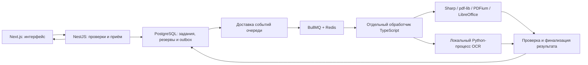

# Очередь заданий и взаимодействие обработчиков

**Дата:** 28 октября 2026 г.  
**Статус:** BullMQ + Redis выбраны пользователем; детали реализации ниже — технический проект, ещё без работающей очереди и испытаний.

Основание — [ТЗ 1.36](./technical-specification-final.md), §§3.7, 4, 6.4, 8–9, 12.8–12.10, и [технологический стек](./technology-stack.md). Отдельные рабочие процессы и допустимость Python для OCR утверждены. Ниже предлагается их конкретное взаимодействие; работающая очередь и нагрузочные испытания ещё не реализованы.

## 1. Что обязана обеспечить очередь

| Требование | Значение / поведение из ТЗ |
| --- | --- |
| Общая вместимость | До 5 активных задач и 100 дополнительных ожидающих на весь сервис |
| Гость / неподтверждённый / базовый | До 1 активной задачи и 5 ожидающих на владельца |
| Pro | До 2 активных и 5 ожидающих |
| Максимальный | До 3 активных и 5 ожидающих |
| Единица задачи | Один исходный файл либо создание одного объединённого PDF |
| Допуск пакета | Сначала отбор по квоте; если все допущенные задачи не помещаются в индивидуальные и общие места, новый запрос отклоняется целиком |
| Ресурсы задачи | До 10 минут активной обработки и 2 ГБ памяти вместе со вспомогательными процессами; ожидание в срок не входит |
| Квоты | Согласованные резервы; ошибка освобождает резерв, успех списывается однократно |
| Отмена | Пользовательской отмены нет; удаление аккаунта снимает очередь и системно останавливает активную обработку |
| Смена тарифа | Принятые задания сохраняются; ожидание запускается по новой параллельности, уже активные задачи завершаются |
| Сбой | Сохранившееся ожидание продолжается; прерванная активная конвертация получает ошибку без списания и автоматического перезапуска |

Наличие готовой очереди не заменяет серверный допуск по тарифам, общий учёт занятости, контроль квот и остановку процессов.

## 2. Выбранная очередь

**Пользователь выбрал BullMQ + Redis.** Для NestJS используется интеграция очереди, описанная в официальной документации; точные совместимые версии пакетов ещё не закреплены. PostgreSQL остаётся базой аккаунтов, заданий, квот и платежей. Redis хранит данные BullMQ и не назначается автоматически кешем или основным хранилищем предметных счётчиков. [Очереди NestJS](https://docs.nestjs.com/techniques/queues).

Ранее сравнивались pg-boss/PostgreSQL и PostgreSQL backend BullMQ. Они не выбраны и не являются текущей рекомендацией вместо решения пользователя. Выбор очереди закрыт; её конфигурация, интеграция и проверка остаются работой реализации.

## 3. Предлагаемое взаимодействие

Схема фиксирует выбранные BullMQ/Redis и предлагает TypeScript-координатор с запуском конвертеров и локального Python OCR. Для работы с PostgreSQL пользователь выбрал Prisma ORM. Схема не назначает маршрут браузер/Next.js/NestJS, версии Prisma, физическое размещение или протокол файлового обмена. Самостоятельный Python-backend для пользователей и платежей не добавляется.

1. **NestJS проверяет запрос.** Проверяет владельца, тариф, входные ограничения, квоты, хранилище и запреты. Антивирус обязателен до миниатюр/конвертации/OCR; точный контракт подготовительных операций ещё нужен. После отбора по квоте все допущенные задачи должны поместиться в индивидуальные и общие места.
2. **Надёжно принимает задание в PostgreSQL.** Предлагается короткая транзакция: сведения о задачах, исходном цикле и резервах, занятые места ожидания и запись события для отправки в очередь. Последняя называется outbox. Неподтверждённая запись в памяти либо одна команда Redis не являются надёжным принятием всей операции. Ответ `202` возможен только после сохранения принятия и необходимых исходников.
3. **Публикует событие в BullMQ/Redis.** Отдельный компонент доставки читает outbox и отправляет задачу с постоянным `jobId`, связанным с идентификатором PostgreSQL. Сбой после отправки, но до отметки о доставке допускает повтор именно доставки сообщения. Worker проверяет актуальное состояние в PostgreSQL, чтобы не повторять уже начатую/завершённую конвертацию. Защита не должна зависеть только от наличия старого `jobId` в Redis.
4. **Запускает работу с учётом всех пределов.** Предлагается одна логическая очередь конвертации с общим пределом 5 активных задач. BullMQ поддерживает global concurrency для всех её workers. Это не заменяет общий учёт в PostgreSQL, индивидуальные пределы владельца, вместимость ожидания и фактическую занятость процессов. Если позднее появятся несколько очередей конвертации, суммарный предел 5 сохраняется, а не выдаётся каждой очереди отдельно. [Global concurrency](https://docs.bullmq.io/guide/queues/global-concurrency).
5. **Исполняет конвертер отдельно.** В короткой транзакции допуска к активному исполнению проверяются актуальная параллельность, состояние владельца и однократность старта; выдаётся уникальное разрешение исполнения. Долгая SQL-транзакция на всё время обработки не открывается. Конвертер получает только конкретные рабочие файлы и параметры; пользовательские ключи/сессии, платёжные секреты и учётные данные БД в Python или нативный конвертер не передаются. Способ изоляции ещё выбирается.
6. **Публикует успех однократно.** После проверки и сохранения результата короткая финализация в PostgreSQL проверяет разрешение исполнения и состояние аккаунта, публикует метаданные и списывает резерв исходного цикла. Состояние BullMQ не является единственным основанием успеха. Файловое хранилище и Redis не входят в SQL-транзакцию: ошибки каждого этапа требуют сверки и очистки осиротевших файлов.
7. **Выдаёт состояние через NestJS.** Клиент опрашивает API в пределах ТЗ; Redis и очередь ему напрямую недоступны. Скачивание ZIP использует готовые результаты, без новой конвертации.

Outbox и обработчик доставки — техническое предложение для согласования PostgreSQL и Redis; задание, резервы и outbox записываются через выбранную Prisma в одном транзакционном контексте PostgreSQL. Повтор доставки служебного сообщения не равен повторной отправке исходника пользователем. При недоступном Redis уже надёжно принятые ожидания сохраняются в пределах общей вместимости; сообщения ожидают доставки, а недоступность обработки отслеживается мониторингом. Новые запросы не принимаются сверх пределов и не получают ложного подтверждения.

При потере данных Redis очередь восстанавливается только для надёжно принятых, ещё не начатых заданий PostgreSQL с сохранившимися исходниками. Прерванные активные задачи не возвращаются в ожидание; готовые задачи не запускаются заново. Запись событий не создаёт автоматической резервной копии временных исходников: при их утрате действует ошибка по ТЗ.

Порядок выдачи задач конкурирующих владельцев, протокол обработчика, изоляция и конкретная реализация outbox ещё не выбраны. Платный приоритет автоматически не добавляется.

## 4. Ошибки, повторные события и остановка

- **Для обычных ошибок конвертации:** предлагается явно задавать `attempts: 1`, без автоматического повторного исполнения. Параметр количества попыток описан в [документации BullMQ](https://docs.bullmq.io/guide/retrying-failing-jobs).
- **Для потери блокировки worker:** отдельно учитываются stalled jobs. BullMQ способен вернуть их в ожидание, даже если обычные повторы не включены. Предлагается `maxStalledCount: 0` с проверкой поведения закреплённой версии и обязательной проверкой состояния PostgreSQL перед фактическим запуском. Само обнаружение сбоя не отключается. Источники: [stalled jobs](https://docs.bullmq.io/guide/jobs/stalled), [опция worker в исходниках](https://github.com/taskforcesh/bullmq/blob/master/src/classes/worker.ts).
- **Ожидание и начатая обработка различаются.** Не начатая задача с сохранённым исходником может продолжиться после сбоя; начатая и прерванная завершается ошибкой без списания и автоматического повторного старта. Окончательное решение принимается по надёжному состоянию задачи, а не только событию Redis.
- **Поздний ответ не возвращает успех.** После ошибки, отзыва разрешения исполнения или удаления аккаунта запоздавший конвертер не публикует файл и не списывает попытку. Отказ финализации запускает очистку его неопубликованных выходов.
- **Таймер очереди не останавливает дочерние процессы автоматически.** Контроллер исполнения обязан остановить всю группу конвертера и проверить её завершение. Активное место не освобождается, пока обработка фактически продолжает потреблять ресурс. Пределы 2 ГБ и 10 минут реализуются средствами окружения и контроллером, а не только таймером JavaScript.
- **Удаление аккаунта** прекращает доступ сразу, отзывает ожидание и разрешение исполнения, удаляет ожидающие записи BullMQ и системно останавливает активные конвертации. Если сообщение сохранилось/доставлено позже, проверка состояния отклоняет его до запуска.
- **Обычная смена пароля или отзыв ключа** не отменяют принятые задачи. Смена тарифа сохраняет старые резервы; новые запуски соблюдают актуальную параллельность.
- **Повторы платежей отделены от конвертации.** Для продлений/возвратов ТЗ разрешает точные расписания. Политики `attempts: 1` и `maxStalledCount: 0` очереди конвертации на них автоматически не распространяются.
- **Минимум данных:** в сообщении внутренний идентификатор и необходимые параметры, без документа, паролей, пользовательских API-ключей и прочих секретов. Диагностика и ошибки конвертера не записывают содержимое или исходные имена файлов.

BullMQ допускает повторную доставку при авариях; его выбор не даёт гарантии однократного списания предметных квот. Финализация и защита от повторов в PostgreSQL сохраняются. [Гарантии BullMQ](https://docs.bullmq.io/).

## 5. Проверки перед реализацией и запуском

| Сценарий | Ожидаемый результат |
| --- | --- |
| Несколько NestJS/обработчиков одновременно принимают и запускают задачи | Общие и индивидуальные пределы не превышаются |
| Остаток квоты два, допустимый пакет пять | Отбираются первые два; если оба не помещаются по вместимости, новый запрос отклоняется целиком |
| После записи принятия процесс NestJS падает до ответа | Задание/outbox/резервы сохраняются; повтор доставки не создаёт второго исполнения или расхода |
| Redis недоступен или его данные утрачены | Сверка с PostgreSQL; восстановление только неначатых задач с исходниками, без перезапуска прерванных |
| Сбой после публикации BullMQ до отметки outbox | Повтор доставки безопасен, активная/готовая задача повторно не конвертируется |
| Обработчик падает до начала/во время конвертации | Состояния различаются; прерванная активная конвертация не запускается повторно |
| Истечение 10 минут или превышение 2 ГБ | Процессы остановлены, понятная ошибка, нет списания/публикации, очищены временные данные |
| Смена тарифа при занятой очереди | Сохраняются принятые задачи/старые резервы, новые запуски соблюдают актуальную параллельность |
| Удаление аккаунта совпадает с финализацией | Нет доступа, новых результатов и восстановления аккаунта |
| Файл сохранён, финализация прервана | Нет двойного успеха; согласованное завершение либо очистка осиротевшего файла |
| Полная нагрузка ТЗ | 100 активных пользователей, до 5 активных задач, очередь до 100; обычные запросы укладываются в согласованный показатель |

Нужно проверить поведение конкретной версии библиотеки, настройки повторов/истечения, атомарность допуска, ошибки соединения и восстановление вместе с исходниками. Эти сценарии пока не выполнялись.

## 6. Утверждённое решение и оставшаяся настройка

**BullMQ + Redis утверждены пользователем.** NestJS принимает задания; предлагаемый отдельный TypeScript-worker запускает конвертеры и локальный OCR-процесс. Python уже разрешён; OCR-движок ещё не выбран. Отдельная публичная панель очереди, особый платный приоритет и прямой доступ Python к БД не добавляются автоматически.

Для Redis и интеграции требуется:

- размещение в ЕС, ограничение сетевого доступа, аутентификация, защищённое соединение и шифрование сохраняемых данных; секреты хранятся отдельно;
- сохранение данных Redis на диск; конкретный режим и допустимое окно потери проверяются вместе со сверкой PostgreSQL/outbox;
- `maxmemory-policy: noeviction`, чтобы Redis не удалял ключи очереди как кеш. При нехватке памяти — контролируемая ошибка и сигнал, а не незаметная утрата задания;
- наблюдение за доступностью, памятью, задержками, активными/ожидающими задачами и ошибками публикации; Redis включается в процедуры восстановления сервиса;
- согласованная очистка служебных записей BullMQ: удаление задания из Redis не снимает требования к однократности и не заменяет сроки журналов/данных приложения.

Сохранение на диск и отсутствие вытеснения ключей описаны в [рекомендациях BullMQ для production](https://docs.bullmq.io/guide/going-to-production). Конкретный режим сохранения, размещение Redis, версии BullMQ/Redis/интеграции NestJS, конфигурация соединений и операционные процедуры ещё не закреплены. Redis не объявляется кешем для остальных функций проекта.

Нужны реализация outbox, ограничений/финализации, протокола обработчика, изоляции и политики выдачи задач. Выбор самой библиотеки очереди повторно не запрашивается. Бюджет и организационные вопросы здесь не обсуждаются.
